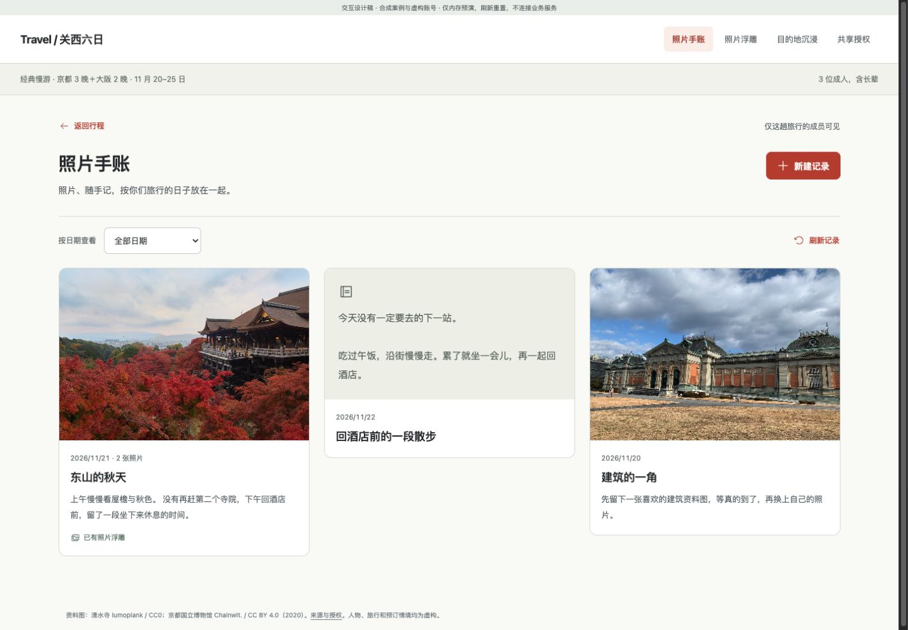

# Travel Agent 旅行决策与记录设计稿

2026-11-11。六个规划场景保留为可点击设计稿；本轮补齐照片手账、照片浮雕、目的地沉浸与共享授权的完整交互，并将这四项接入正式 Preact 工作台和 Java 服务。设计稿的合成旅行不等于真实旅行来源或宿主验收。

## 打开与运行

运行后打开 [整套设计稿](http://127.0.0.1:5176/) 或 [记录与共享交互](http://127.0.0.1:5176/media.html?view=journal)。评审页提供十个场景、桌面与手机切换；也可单独打开当前画面。

```sh
npm --prefix plugins/travel-agent-openai/workbench ci --ignore-scripts
node plugins/travel-agent-openai/workbench/node_modules/vite/bin/vite.js --config design/2026-11-11-user-journey-review/vite.config.mjs
```

## 从选择旅行到留下记录

| 场景 | 旅行者的决定 | 动作后的含义 |
| --- | --- | --- |
| 选整趟方向 | 京都／大阪怎样住宿和移动 | 选择方向后展开每日试排 |
| 看每天安排 | 为什么这样排，哪里可改 | 到访与地图联动，打开局部比较 |
| 比较上午 | 寺院、室内博物馆或休息 | 选择备选后预览连带影响 |
| 看连带影响 | 接受哪些时间、休息和费用变化 | 确认后一起更新试排，尚未采用 |
| 审阅并采用 | 是否知悉具体未知条件 | 采用后仍标为暂定，缺口继续可见 |
| Today | 接下来做什么、变化影响哪里 | 保留采用版，先看建议和影响 |
| 照片手账 | 哪一天、哪次到访、什么想记下来 | 可纯文字，可后补地点；明确保存、编辑和删除 |
| 照片浮雕 | 怎样保留这张照片的层次效果 | 本机预览，明确保存效果，源照片不变 |
| 目的地沉浸 | 想先探索哪个地点、看哪一章 | 可旋转、切地点和导览，返回原旅行；不修改安排 |
| 共享授权 | 给哪个已注册账号、什么权限 | 先核对身份与影响，再授权；可改权限或撤销 |

六个规划场景仍是设计材料，不声称方向选择、完整地图和连带更新均已接入服务。记录与共享稿直接复用生产组件；`media.jsx` 的内存宿主只属于设计目录，刷新重置，正式插件不引入它。

## 桌面与手机

桌面手账以照片和文字为主，编辑使用宽侧层，将内容与日期／到访分栏；浮雕、沉浸和共享也在各自侧层完成。手机手账单列，编辑使用全高层，信息顺序排列；侧层铺满屏幕，操作栏保持可见，内容独立滚动。关闭侧层回到原触发位置；未保存内容明确选择保留编辑或放弃。保存结果未知时按原次请求重试，不重新创建记录或授权。



[手机手账](./screenshots/mobile.jpg) · [桌面编辑](./screenshots/desktop-editor.jpg) · [手机编辑](./screenshots/mobile-editor.jpg) · [桌面浮雕](./screenshots/desktop-relief-draft.jpg) · [手机浮雕](./screenshots/mobile-relief.jpg) · [桌面沉浸](./screenshots/desktop-immersion.jpg) · [手机沉浸](./screenshots/mobile-immersion.jpg) · [手机章节](./screenshots/mobile-immersion-chapters.jpg) · [桌面共享](./screenshots/desktop-sharing.jpg) · [手机共享](./screenshots/mobile-sharing.jpg) · [861px 工作区](./screenshots/user-861.jpg)

## 保存与权限的具体规则

- 从“记录这一天”“写旅行记录”或手账新建。标题、日期与到访均可后补；标题、文字、照片至少有一项。每条最多 3 张照片，每趟最多 40 条。
- 照片可增删排序。保存后修改使用记录版本；并发冲突保留本地编辑，让用户决定是否载入云端版本。记录与效果的修改不推进旅行版本。
- 浮雕先选照片，再调整风格、层次与视角。“保存效果”只保存该照片的参数；取消保留上次效果。食物照片不保存浮雕。
- 共享覆盖同一旅行的行程、手账、照片与效果。查看者不能保存或删除；编辑者可编辑记录但不能管理共享。拥有者核对 Google 账号和权限后才授权，非 Google 托管邮箱显示归属提醒。转发聊天或入口文件不授予权限。
- 删除前说明记录、照片与效果会永久删除，行程保持原样。撤权后后续媒体读取和写入均执行相同权限检查；已下载副本无法收回。

## 本轮验证边界

桌面 1440px、手机 390px 和工作区 861px 已实际操作并目测。`screenshots/media-observations.json` 记录观察与服务验证范围。真实 Java／MCP／临时 PostgreSQL 的浏览器路径完成了两张许可照片上传、保存、刷新回读、浮雕保存与源图片比对、排序、共享查看、编辑和撤权；账号与旅行来源为合成输入。自动回归另覆盖幂等、记录冲突、删除及照片身份隔离。

没有真实 Google 登录、Codex／ChatGPT 原生入口、真实手机硬件或授权旅行来源；没有完成公开插件发布。不能把设计内存预演或本机服务验证算作这些验收。

## 资料与原型参数

行程、价格、航班、酒店选择、跟进与天气是明确的设计情景。地图使用带署名的 OpenStreetMap，近似坐标和顺序线不代表导航或已核验耗时。馆方公开信息只用于设计案例核对。

照片文件保持原样，来源、许可和哈希见 `assets/sources.json`；清水寺为 lumoplank / CC0，京都国立博物馆为 Chainwit. / CC BY 4.0（2020）。图标使用已有 Phosphor 2.1.10，许可在 `assets/icons/LICENSE`。生产组件不带这两张示例照片。

核心画面参数：`frame=1`、`stage`、`route=a|b|c`、`day=1..6`、`after=1`、`ack`。新增 `stage=journal|relief|immersion|share` 打开对应完整交互。直接记录稿使用 `media.html?view=journal|relief|destination|share`。参数只是设计场景，不能授予权限或提交正式状态。`evidence/` 保留被否定旧稿的问题证据。
