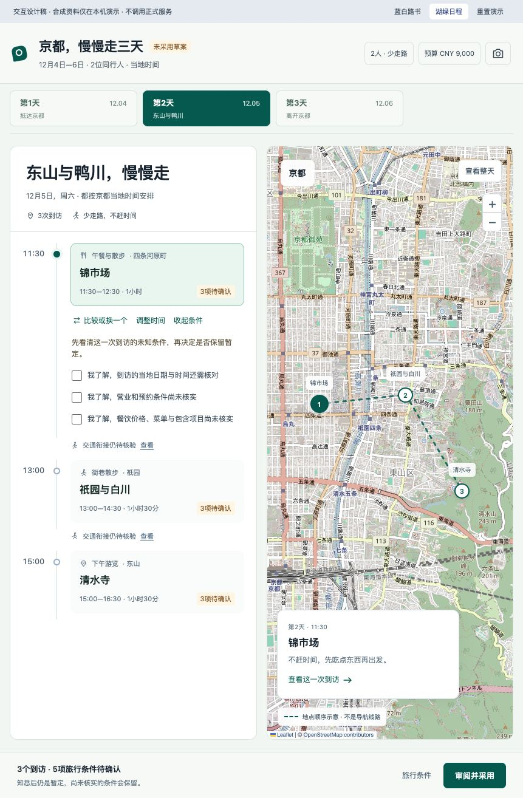
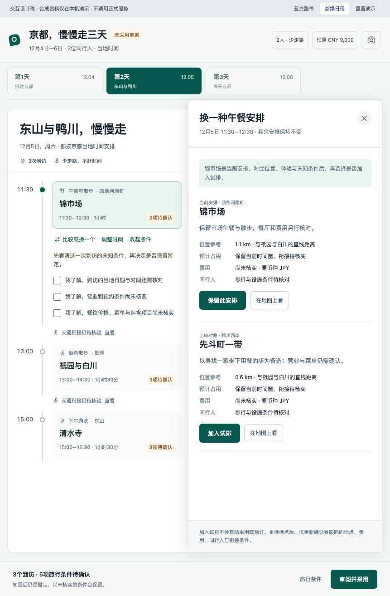
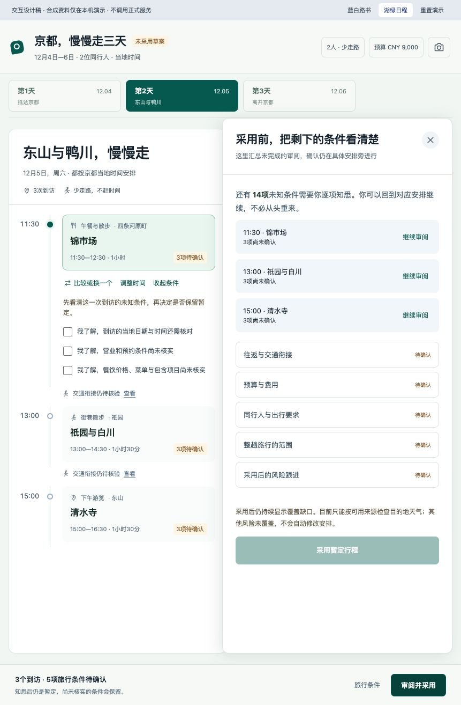
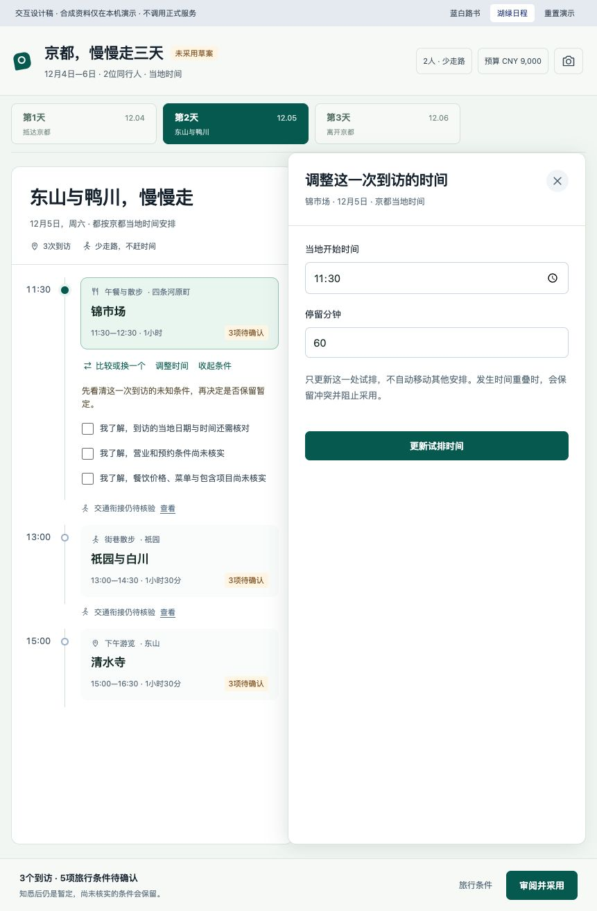

# Travel Agent：从用户决策重做工作台

状态：设计探索，2026-11-11。旧两版界面已被用户否定，不作为视觉或交互基准。已产出可点击主流程设计稿与桌面／手机画面；本轮按用户后续授权补齐四项记录与共享交互，并替换对应正式插件界面与服务。核心规划稿仍是设计材料。

## 这次要解决什么

用户已经在宿主聊天表达旅行需求。工作台要让他看懂这趟旅行、判断推荐是否适合自己、修改一处并理解连带影响，最后清楚地确认所选安排。页面围绕旅行和选择展开，不围绕数据表、工具状态或确认数量展开。

继续保留：宿主聊天、按天安排、到访与地图联动、侧层比较、逐项知悉未知条件、按账号保存确认进度、仅让依据变化的确认失效、已订和锁定内容保护。采用暂定行程不等于核验、预订或购买。

## 当前稿的问题证据

本次实际打开并截图检查了原型，未保存任何输入或改变行程选择。原图与逐步记录位于 `evidence/`。

| 步骤 | 用户想完成什么 | 当前问题 | 新稿必须回答什么 |
| --- | --- | --- | --- |
| 当天安排 | 判断这一天是否想去、是否适合同行人 | 只有地点、时间和通用未知项；安排理由、节奏、吃住行完整度不清楚 | 为什么推荐、当天怎么走、哪里尚未安排、下一步能做什么 |
| 比较午餐 | 找到更适合自己的具体选择 | 把两个片区各介绍一次，让用户自己推算差异 | 可比的具体对象、推荐理由、时间／费用／同行人取舍、对当天的影响 |
| 改时间 | 调整一处并让旅行仍然成立 | 只改当前项，用户需要自己解决后续冲突 | 变化前后、受影响安排、受保护内容、无法解决的条件 |
| 采用 | 明白自己决定了什么 | 14 项确认主导页面，整趟旅行的内容和缺口缺少整体表达 | 采用的具体安排、仍未解决的问题、暂定含义、跟进实际覆盖 |

本次只检查了当前桌面工作区；未做手机、完整无障碍、真实宿主或真实来源验收。侧层打开时焦点进入标题，关闭后未返回原触发控件，新稿需要补齐键盘返回路径。

信息也必须自洽。馆方公布京都国立博物馆 2026 年 12 月 1—20 日仅庭园开放，不能把它作为该日期的室内参观替代方案。已知不适合、尚未核实和可以选择必须分别表达；不能用同一个“待核实”标签掩盖这些区别。

依据：[馆方开放说明](https://www.kyohaku.go.jp/eng/visit/info/)。这是设计案例核对，不代表生产 Provider 已接线。

## 逐屏内容，而非先选皮肤

| 画面 | 首要信息 | 主要动作 | 动作后的明确反馈 |
| --- | --- | --- | --- |
| 第一份旅行结果 | 整趟范围、同行需求、已有安排、还缺什么 | 比较 2–3 条整趟旅行方向，选定后展开每天 | 清楚进入当前选择，不重复录入聊天中已经提供的要求 |
| 一天的安排 | 当天主题与理由；早餐、到访、午餐、交通、休息、晚餐和住宿；已记录／建议／待选各自明确 | 选中到访、看地图、补齐待选项、比较或修改 | 当前对象始终一致，返回后保留日期、选中项和阅读位置 |
| 一次候选比较 | 当前安排与备选采用相同标准；最有用的差异、推荐理由、事实或估算依据、未知条件 | 查看证据、比较其他候选、选择一个方向 | 明确目前仍在比较，尚未改动采用版；不静默减少候选 |
| 一次改动 | 原安排与新选择、时间与费用差异、受影响对象、锁定与已订项 | 预览关联安排、时间与费用，确认后一起更新试排 | 显示准备中、完成、失败和取消；失败保留原安排，不能只显示“操作成功” |
| 采用前审阅 | 将采用的旅行、费用覆盖、未解决事项、跟进覆盖；到访及交通条件仍可定位回去 | 到对应安排逐项确认，最终统一采用 | 每项说明已保存选择还是事实已核实；关闭后可继续，依据变化时说明哪项需要重确认 |
| 采用后与 Today | 今天下一步、要带什么、真实变化及其影响；采用版和建议分别表达 | 查看依据、比较调整、确认建议或保留原安排 | 用户知道变了哪里；建议、已提交与已采用不会混为同一种状态 |

手账、照片、照片浮雕、目的地沉浸、准备事项和指定账号分享保留清晰入口；不会为了首页简洁移除已有业务能力。工作台不新增独立聊天框。

## 信息表达规则

- “午餐待选择”不能伪装成“已安排好锦市场午餐”。片区、具体餐厅和已预约记录是不同对象。
- 路线、交通方式、时间、步行负担和费用放在相邻安排之间；直线距离不能代替出行耗时或导航路线。
- 预算区分用户记录的费用、估算和未计入项目；保留原币种、计价单位、人数与日期范围。费用有缺口时不声称全程预算已成立。
- 关键限制说明实际影响，例如“当日展厅不开放，不能作为室内备选”；未知项说明缺少的事实及用户可选的下一步。
- 采用前的知悉记录继续逐项保存，但不让通用复选框代替安排理由和实际决策。
- 每个操作只有一个明确含义。选择、预览、更新试排、采用和预订跳转分别命名，不能靠一次“确认”混用。

## 界面稿交付范围

用同一趟包含往返、多城市、住宿、餐饮、休息和同行约束的旅行贯穿各画面，避免只画三个景点的理想状态。所有示例预订、价格、路线估算与天气情境清楚标为设计资料。

先交付桌面与手机的高保真关键画面、变化前后和操作顺序，让用户能够沿着同一个任务评审。核心规划场景保持设计材料；记录、浮雕、沉浸及共享按用户后续“可以替换 UI”授权接入正式组件。

## 本轮已确认的行为

1. 用户在宿主表达需求后，工作台先给两三条整趟方向，选定才展开每日安排。
2. 修改地点或时间，先预览连带安排、时间、费用和固定项，确认后一起更新试排。
3. 采用前在具体到访与交通旁逐项知悉；记录随账号保存在同一旅行，只有依据受影响的项需要重新确认。设计原型用场景参数示意，不实现保存。

## 当前具体设计稿

[本地评审入口](http://127.0.0.1:5176/)包含桌面与 390px 手机画面。按顶部十个场景依次评审，也可以实际点选方向、日期、候选、影响预览、逐项知悉和采用。

同一案例：2026 年 11 月 20—25 日，3 位成人含长辈，上海往返关西。三条方向为京都 3 晚＋大阪 2 晚、大阪 5 晚、京都 5 晚；在同一组问题下比较住宿移动、跨城负担、需要接受的取舍及费用缺口。日程示例贯穿抵达、普通游览、换酒店和返程，不把地图上的顺序线当成导航。

详细预览用“清水寺换成博物馆”贯穿：午餐、祇园与休息后移，休息缩短，固定晚餐和航班保留。旧费用缺失时，净差额明确未知。采用前只重看入场、出发接驳及午餐前接驳；其他记录保留。Today 延续已换入的博物馆，天气变化影响下午祇园，不把先前清水寺偷偷放回行程。

地图、预算、完整交通、准备、分享和照片手账均有二级入口。照片手账、浮雕、目的地沉浸和共享授权现已补齐完整交互，详见同目录 README 的操作、保存和权限规则。旧入口草图仅作历史对照。

原型边界、运行方式、场景参数、图片许可与本轮观察记录见同目录 README。

## 本轮观察截图

以下为用户已否定的旧稿，只作问题证据，不是本轮的新设计。

### 1. 理解当天安排：信息不足

### 2. 比较午餐：缺少可直接判断的差异

### 3. 采用前审阅：确认数量盖过了旅行本身

### 4. 修改时间：缺少连带影响的预览

## 本轮补齐的完整路径

手账从日、到访或全旅行新建；先记录文字也可以，日期和地点以后再补。内容与照片在主编辑区，日期、关联到访与照片内容类型放在上下文区。保存后进入记录详情，用户可以继续补照片、排序和编辑；冲突保留本地内容，不能悄悄覆盖云端。

浮雕从已保存照片进入，明确当前选中哪张；风格、层次、对照原图和视角分别操作。只有“保存效果”保留参数；源照片保持原样。离开时有未保存调整，需要明确放弃或继续。设备不支持三维显示时保留原照片及恢复入口，不显示假完成。

目的地沉浸以地点、场景和章节为中心，支持旋转缩放、导览、表现切换及返回。场景来自风格化主题，不冒充实景；来源失效不能继续当作当前地点依据。手机将章节放在场景下方，操作栏仍可返回原行程。

共享先看当前成员和范围，再输入 Google 登录邮箱；找到账户后单独核对身份和权限影响，确认才提交。更改权限与撤销都先展示影响。失败可重试，结果未知保留原次操作；撤权立即阻止后续服务操作，不承诺收回已经下载的副本。
