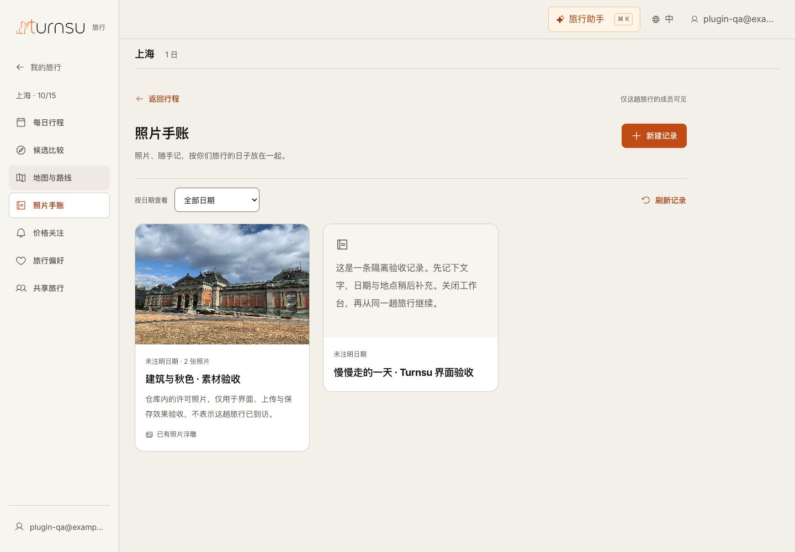

# Turnsu 统一旅行工作台

2026-11-14。统一设计和正式 React 界面采用同一套组件、导航与 Turnsu Design System。正式数据通过 DSH（旅行助手执行与恢复基座）和 TypeScript 旅行服务保存到 PostgreSQL；设计预览使用明确标注的虚构旅行，不会连接真实账号或修改云端数据。

## 设计语言

工作台采用规范中的暖白表面、Inter 字体、墨色文字、主操作与状态语义，统一字阶、圆角、表单、分组和 44px 触控区域。原始资源固定版本与许可见[样式来源](../../src/web/design-system/README.md)，现行规则见[DESIGN.md](../../DESIGN.md)。本轮验收浅色界面；产品操作继续沿用下述约定。

## 设计与操作

桌面左栏承载旅行导航，主画布以每日安排为主；点击到访联动地图并打开详情。候选、连带调整、采用前审阅在相应层中处理。手机和窄插件栏使用顶部 Turnsu Logo 与按需展开的菜单。

| 入口 | 用户完成的操作 |
| --- | --- |
| 每日行程 → 记录这一天；地点详情 → 留下旅行记录；照片手账 → 新建记录 | 可先写文字，日期、到访、照片均可后补；编辑和排序保留同一记录与照片身份 |
| 手账详情 → 打开照片浮雕 | 本机预览、对照原图、调整风格和远近、环看；点击“保存效果”后保存到同一照片；未保存离开提醒 |
| 地点详情 → 先感受这里 | 切地点、章节、热点、视角、导览与场景依据；返回原地点；场景是风格化表现，不表示现场或导航事实 |
| 共享旅行 | 输入已注册 Google 邮箱，核对账号与查看/编辑范围，再确认；可变更和撤销权限 |
| 试排 → 审阅并采用 | 在受影响的到访或交通段旁逐项确认未知条件；按账号保存进度；已知冲突继续阻止采用；采用后保留“暂定行程”及缺口 |

插件每次重新打开播放约 1 秒的品牌进入动画：居中出现 → 放大 → 回缩 → 移至导航 Logo 位。与数据读取并行，启动界面切换会接续原动画时间；切旅行、标签、展开侧栏或画布不重播。减少动态效果时直接显示导航 Logo。桌面落在左栏顶部，手机/窄栏落在顶部。

首屏以真实安排、日期、主要操作为主，避免将实现说明或开发指令放入正式产品。来源不可用、权限不足、保存冲突和保存结果未知分别说明并给出恢复操作。

## 打开设计稿

在仓库运行 `npm run web:dev -- --port 5181`，打开 `/design/unified-workbench/index.html`。设计数据仅在当前页面内存中保存，刷新即重置。该页面用于审阅设计；正式入口是主站与插件共享的 React 画布。

正式运行和本轮验证见[统一实现记录](../../wiki/research/2026-11-11-unified-turnsu-workbench.md)。Logo 原样来自用户素材包，哈希见[品牌来源](../../src/web/brand/README.md)；设计照片的作者、许可和固定哈希见 [sources.json](./assets/sources.json)。

“先给两三条整趟方向”的上游规划行为仍需单独开发验收，本轮统一不以新的导航替代该能力。

## 实际界面

以下为正式 Web 的受控资料截图；设计预览仍使用自己的内存资料。设计规范迭代的源码、代码复核与 UAT 边界见[本轮记录](../../wiki/research/2026-11-14-turnsu-design-system-refinement.md)。

[手机手账](../../wiki/research/assets/2026-11-14-turnsu-design-system/journal-mobile.jpg) · [手机浮雕](../../wiki/research/assets/2026-11-14-turnsu-design-system/relief-mobile.jpg) · [共享授权](../../wiki/research/assets/2026-11-14-turnsu-design-system/sharing-mobile.jpg) · [目的地沉浸](../../wiki/research/assets/2026-11-14-turnsu-design-system/immersion-mobile.jpg)
