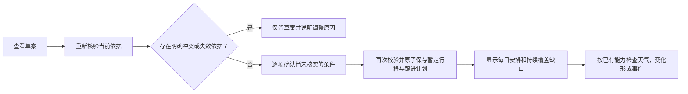
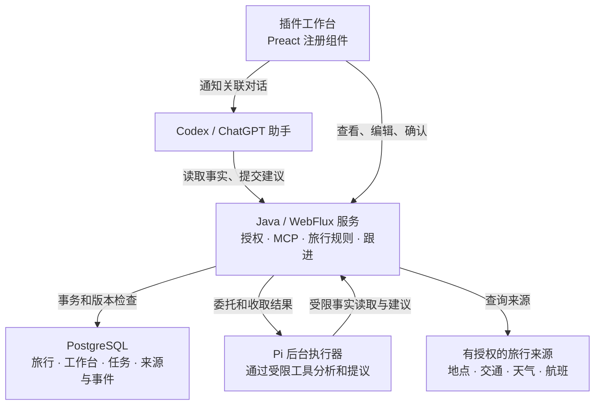
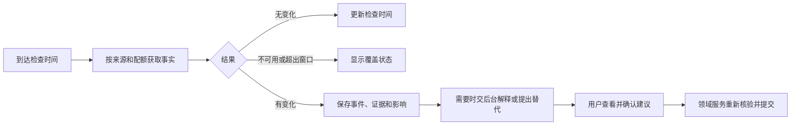

# Travel Agent OpenAI 主线技术方案

**适用范围：**2026-11-06 用户确认的全球旅行产品，首期运行在 Codex 和 ChatGPT。**状态：开发中，尚未完成真实宿主、旅行来源或公开发布验收。**本文描述目标架构；具体已完成内容以[开发计划](./18-openai-travel-development.md)为准。

用户在宿主的对话里说明旅行需求，在插件工作台查看地图、每天的安排、待确认方案和后续变化。旅行采用后，服务持续检查有来源支持的风险。服务负责保护已采用的安排：助手或后台发现新信息时只能提出建议，用户确认后才重新核验并提交。

旧 Web、原生壳、小程序和 Claude 接入保留为旧版本资料；它们的实现、测试及历史验收结果不能被当成新主线已经接通。旧的旅行规则和测试用于迁移对照，旧开发数据不迁入新数据库。

## 用户体验与边界

- 国内、入境、出境和跨国旅行都使用同一份旅行，吃、住、行、玩、往返及跨城交通相互影响。保留多次到访、每位同行人的约束、原币种和计价单位、坐标系、IANA 时区及来源时间。
- 宿主助手处理当前聊天；用户在工作台选择和确认。插件不再另造一个与宿主并列的聊天窗口。地图和每日行程保持稳定，助手只能组合已注册的候选、预算、证据、交通、准备、跟进、Today、手账、照片浮雕与目的地沉浸组件。
- 预订只准备跳转并记录用户确认；不执行购买、自动退改或社交平台写入。来源无法提供开放、预约、库存等事实时，向用户说明缺少什么，不能把地图资料说成实时库存。
- 手机首期覆盖查看变化、Today、查看调整、继续对话和轻量确认。桌面和网页覆盖完整地图、照片及工作台；具体宿主能力必须逐端验证。OpenAI 官方目前说明网页扩展对部分套餐仍在逐步推出，不能假定所有账号均有相同入口。
- 原始照片按现有压缩、去除 EXIF 和容量限制处理；证件、手机号、支付资料、Cookie、Token 和浏览器 profile 不进入模型输入、业务状态、日志或成果。敏感信息识别是多层边界，不能将一个正则过滤器视为完整保障。

## 暂定行程与采用确认（2026-11-11 已确认）

当营业、预约、交通衔接、费用或同行人条件无法核实时，用户可以在工作台逐项确认自己已了解这些未知条件，再采用**暂定行程**。采用会保存当前列出的到访，并持续显示未核实条件及风险跟进覆盖缺口；确认知悉不等于事实已核验。已发现的时间冲突、已知费用超预算、失效的地点引用或版本冲突，仍要先解决，不能通过勾选跳过。

确认进度按账号保存在同一云端旅行，关闭页面、换设备或宿主后继续；同行人的确认不能代替当前账号。每项确认绑定它实际读取的地点、时间、来源事实或旅行要求，只有依赖变化的项需要重新确认，旅行版本变化本身不会清空其他确认。相同事实重新查询也不清空确认；来源失效仍会阻止采用。重复点击或断线后使用原请求标识恢复，不重新执行旧勾选。当前只实现首次暂定采用；已有采用版的修改或替换仍需迁移完整影响核验，不能直接覆盖。完整已核验采用尚未实现，天气后来取得结果也不会把暂定行程自动改成已核验。

采用操作明确展示并启用风险跟进。目前执行范围只有目的地天气，来源未授权、不可用、日期不明确及超出预报窗口分别显示；航班、营业、预约和交通衔接作为持续可见的覆盖缺口。天气检查每小时一次，后台独立取数，页面刷新只读取已保存状态；只读检查不占用 Pi 规划代次。默认停止时间按当前最后一次到访或已记录交通的较晚结束时间再加 24 小时计算，在确认页展示；这不证明完整返程已经核验。用户可暂停及在结束前恢复，撤权和结束会阻止迟到结果保存。

### 实现与验收对应

- `verify_trip_itinerary_draft` 返回明确冲突、每次到访及每位同行人的未核实项、跟进覆盖缺口、两类采用资格与确认摘要。`canAdopt` 只表示全部检查通过；`canAdoptTentatively` 只表示可以进入逐项确认，不能直接当作已采用。
- `get_trip_itinerary_review` 为工作台读取当前核验和本账号的云端确认；`save_trip_itinerary_review_condition` 保存或取消一项确认。服务生成每项 `basisDigest`（该条件所依赖内容的摘要），并校验旅行、草案、独立确认版本与幂等请求。预算变化只影响读取预算的条件；修改一个到访不会清空其他到访的确认。两项工具只展示给应用，助手的核验工具不返回私人确认进度。
- 工作台使用 `adopt_tentative_trip_itinerary`，携带当前旅行版本、草案版本、`reviewDigest`（所见核验依据的内容摘要）、逐项 `acknowledgments`、本次开启跟进的明确同意与幂等请求标识。服务重新计算摘要、要求确认集合完全一致，并检查本账号的每项云端记录仍匹配当前依据。工具仅展示给应用，真正的账号权限及版本校验仍由服务执行。
- `planning.adopted.status` 保存为 `tentative`；到访、核验快照、知悉的条件标识和采用者时间保存在同一旅行。原草案改为 `adopted`，预算、同行人和已订交通保持原值，旧助手请求失效。不能把任务完成或界面消息当作采用成功。
- V15 迁移增加采用状态、跟进执行记录和天气变化事件。跟进只保存来源引用及比较摘要；来源原始资料仍遵守有效期和清理规则。相同资料不重复产生事件，失去有效基准后重新建立基准，不声称期间没有变化。取得变化后只记录事件，不自动改行程。
- V16 迁移保存账号与旅行的确认进度；撤销共享权限时相应进度一并删除，旧请求即使已有回执也不能绕过当前权限。采用快照保存匹配的确认依据和时间。同一次到访在草案更新中沿用 `stopId`；同一地点的不同到访保留独立标识。
- `get_trip_follow_up` 提供覆盖、最近尝试、最近成功、下次检查和分页事件；`set_trip_follow_up` 使用旅行版本、独立跟进设置版本及请求标识暂停或恢复。工作台可见时每分钟读取最新状态，重开立即读取；没有系统推送或真实宿主提醒的验收承诺。

## 系统如何分工

Java 旅行领域服务是唯一正式写入者。它根据旅行版本、读取依据、允许修改范围、用户锁定项、来源新鲜度、预算和跨领域影响决定能否提交。宿主助手和 Pi 均不能绕过这条规则写数据库。Pi 使用服务端自有模型额度，不持有业务数据库权限；模型执行失败或额度不足时，任务保留真实状态，不报告完成。

PostgreSQL 保存旅行、权限、任务、跟进和事件；布局、组件参数可用 JSONB，媒体二进制与元数据分开存放。初期是一个服务应用，不以额外消息队列或另一套旅行状态作为前提。生产数据库需要可验证的备份和恢复。

### 三种容易混淆的对象

| 对象 | 用户可理解的含义 | 版本或权限 |
| --- | --- | --- |
| 来源结果引用 `ResultReference` | 某次真实查询得到的资料及其来源、检查时间、有效期、完整度 | 继承旅行访问权限；来源条款可能限制缓存和展示 |
| 工作台文档 `WorkbenchDocument` | 当前有哪些注册组件、它们的位置及绑定的数据 | 独立布局版本；保护用户固定、修改或删除的内容 |
| 旅行和变更建议 | 正式安排、草案及等待确认的变化 | 旅行版本；建议不能自行覆盖已采用内容 |

工作台只引用真实结果，不因组件不兼容而缩减候选或删除内容。迟到结果保存为待采纳建议；每个组件的数据缺失、权限不足或来源不可用都要显示具体原因。

### 身份、分享和入口

新主线只使用 Google 确认个人身份，再通过 MCP OAuth 授权插件。客户端必须使用精确回调地址、PKCE S256、资源和 scope 校验；令牌轮换、撤销和账号隔离由服务负责。聊天 ID、工作台实例 ID 和文件都不是访问凭据。旅行默认私有，可向指定已注册账号授予查看或编辑权限并撤销；照片和结果引用遵循相同权限。

分享者在工作台输入对方用于 Google 登录的邮箱，确认查找到的账号及查看／编辑权限后授权。Google `sub` 是稳定账号标识；邮箱只用于查找，必须来自通过签名和声明校验的 Google 身份且 `email_verified` 为真，邮箱改变或多账号匹配时不得自动猜测。Gmail 地址可忽略大小写；其他邮箱保留用户名部分的大小写及 Unicode 写法，以免定位到不同账号。此前被完整小写化的第三方邮箱需要账号再次通过 Google 登录后才能用于查找，已有授权仍绑定原账号。用户确认首期允许所有 Google 已验证邮箱；对于 Google 不负责托管的第三方邮箱，工作台提醒分享者核对当前账号归属。[Google 官方说明](https://developers.google.com/identity/gsi/web/guides/verify-google-id-token)指出这类邮箱的控制权可能在最初验证后发生变化。

工作台在本地规范化邮箱并计算查找摘要，MCP 查找参数不携带原文；共享列表中的邮箱只放在应用展示数据中，模型可见结果只含操作状态。只有旅行所有者能查找和管理授权，权限变更使用独立版本；撤销后立即移除访问并阻止相关后台任务继续写入。实际宿主是否严格隔离应用专用工具和展示数据，仍需在 Codex 与 ChatGPT 中以测试账号验证；当前隔离宿主检查不能代替真实宿主的隐私验收。

三个入口是侧栏旅行列表、对话侧栏的当前旅行和桌面 `.traveltrip` 文件。入口文件只含格式版本、服务和旅行标识；通过宿主资源接口读取，转发文件不会转移权限。对话无关联旅行时需要选择。OpenAI 当前扩展规范将文件入口列为仅桌面支持；若真实验收确认网页不支持，网页从旅行列表或对话进入同一份云端旅行，手机也通过旅行列表或对话进入。该兼容方式经用户于 2026-11-06 确认。宿主桥接集中处理连接、文件、显示模式和消息回执：先保存请求再通知关联助手；发送结果未知时允许恢复，不自动重复发送。

目标是标准 MCP Apps 和 OpenAI Extensions。同一服务发布版本一致的 UI 资源；插件包分发 Skills、MCP 连接和入口。宿主实际支持与文件读取必须在 Codex 和 ChatGPT 分别验证；SDK 格式检查不等于原生入口已通过。组件操作的宿主可见性只是 UI 协议提示，真正授权仍由服务根据账号、旅行角色及版本完成。

## 采用后持续跟进

用户采用旅行时同一操作说明并启用执行风险跟进，展示覆盖范围、最近成功检查和下次检查时间。默认检查天气、航班状态、交通衔接和已选地点的开放或预约条件；价格机会与自定义任务由用户指定对象、条件和截止时间后开启。自定义任务只能选择已登记的数据能力，缺少来源或必要条件时不能假装已经监测。

同一查询允许合并时才共享来源请求；没有变化不调用模型也不重复提醒。国内高德、飞猪、途牛和海外 Google Maps、Skyscanner、Viator 等按授权和实际能力接入；航班计划使用 Cirium／FlightStats 只读状态接口，检查时间须适应其覆盖窗口。场所开放和预约变化使用官方或授权来源。Google Places 等受限资料按来源政策缓存和使用，不能永久保存所有原始地图内容。

高德[公开服务协议第 3.3、3.5、7.3 条](https://lbs.amap.com/pages/terms/)对商业使用、存储缓存及授权范围作有限制。当前地点结果会保存并可提供给工作台和规划执行器，30 分钟仅是技术过期上限，不证明这些用法获得许可。启用前须取得并核实适用许可：至少确认地点、天气和路径结果可否按当前方式保存、显示、供助手和执行器使用，以及可保存的期限；不允许的内容要调整为合规读取或替换来源。公开条款与具体合同的适用范围需要向高德确认，单有 API Key 不构成上述授权。

用户打开移动工作台时读取未读变化；继续旅行对话时助手先读取重要变化。仅打开历史聊天而没有调用插件或助手，不算自动提醒；首期不依赖系统推送。默认执行风险跟进在旅行结束后 24 小时停止；取消旅行或关闭跟进立即停止，价格和自定义任务各有明确截止日期。

### 前台接管

继续规划时，宿主助手显式接管相关任务，服务递增执行代次并返回检查点和最新旅行。旧后台执行器即使迟到也不能提交；天气等只读检查继续。仅打开页面或查看变化不接管。助手结束或明确交回后，后台从最新版本继续，已经被新要求替代的旧规划不自动重跑。接收、开始、保存结果和用户采用分别记录，消息发出不等于任务完成。

## 宿主与构建的当前实现

工作台组件通过中立的 `TravelHostPort` 调用服务。标准 MCP 适配器与 OpenAI 扩展适配器共用账号校验、错误恢复和打开顺序，OpenAI 的文件和消息扩展只进入对应页面。每次读取或保存前后核对稳定账号；切换账号、连接失效或失去旅行权限时清空当前页面资料，并使迟到结果失效。窗口重新可见时检查身份，不因此发起研究。

关联对话必须由宿主输入同时给出旅行标识和当前请求 `instruction`；它只用于定位，不能授予旅行权限。侧栏空输入、文件入口和其他旅行都不继承该关联。没有关联时保存请求并提供恢复文字；已关联时先保存，再尝试通知宿主，送达未知不会自动重发。文件读取只接受准确资源 URI 的唯一内容，后打开的输入优先。

`contracts/travel-workbench.json` 是组件定义的唯一来源，构建生成前端目录，Java 打包同一份合同。布局版本独立于旅行版本，页面按已保存的可选组件顺序渲染；未知类型或版本显示具体原因并保留原布局。当前合同仍只有每日行程、地图、旅行要求、地点四类；地图和正式每日安排尚未完成，不将注册本身当成功能接通。

构建产出独立的 `mcp.html` 与 `codex.html`。标准页面的依赖检查禁止引入 OpenAI 扩展。服务发布带版本与 HTML 摘要的不可变资源 URI，启动时校验 HTML、组件合同和构建清单是否相符。`open_travel_workbench` 提供 OpenAI 入口，`open_travel_mcp_workbench` 提供标准 MCP 页面。插件生成器再次校验同一摘要，按白名单打包，不复制开发依赖、旧客户端或运行数据。

生产服务仍要求 HTTPS。Codex 可使用明确登记的 HTTP 本机回调；主机、端口和路径精确匹配白名单，公开服务地址不会因此允许 HTTP。原生插件包需要同时给出回调 URL 和监听端口。服务支持动态客户端注册，真实客户端如何选择最终回调仍需原生联调。

后台现在可以提交带来源引用的结构化到访建议。Java 在同一事务内校验当前旅行、任务代次、租约、来源新鲜度和到访合同，保存未采用草案并完成任务；失败时不会留下半份草案。草案核验会重新检查当前版本、来源、时间重叠及与已订交通的关系，返回读取依据和具体未核实项目。营业、预约、库存、完整费用、同行人约束和全程覆盖尚未完整接通。用户逐项确认未知条件后可首次采用暂定行程，并启用目前仅覆盖目的地天气的跟进；完整已核验采用仍未完成，具体确认及覆盖规则见上文。

## 实现合同和默认值

- 运行栈：Java / Spring WebFlux、PostgreSQL、Preact；Pi 在服务端以受限工具执行。当前新服务使用 Spring Boot `4.1.2`、Spring AI MCP WebFlux `2.0.2`、MCP Java SDK `2.1.0`。最终版本以构建锁定和安全维护为准。
- 照片浮雕与目的地风格化场景复用项目已审计的 `three@0.180.0`；浮雕预览在本机生成，保存手账时压缩后的照片上传并存入旅行服务。目的地插画不作为真实景观或路线证据。OpenAI 扩展 SDK `0.2.1` 固定的 Zod `4.4.3` 受 [GHSA-mrhx-c7xc-m3w5](https://github.com/advisories/GHSA-mrhx-c7xc-m3w5) 影响；工作台锁文件将该传递依赖覆盖到 `4.6.7`，已通过本地扩展合同检查。覆盖版本的真实宿主兼容性仍需验收，后续 SDK 更新时重新核对。
- 所有旅行写操作携带 `tripId`、预期旅行版本和请求幂等标识。任务结果另携服务端执行代次；工作台布局使用独立版本。访问检查始终使用服务验证过的账号，而非模型提供的账号。
- 计划中的接口组：旅行上下文；研究、试排与采用；后台委托、进度与接管；跟进、变化和确认；组件目录与布局；媒体和指定账号共享。工具摘要面向模型，UI 展示数据另行返回并各自遵守敏感数据边界。
- 目标容量是 500 个独立账号同时在线，每人两个界面实例；初始后台规划为集群最多 32 个、每用户最多 2 个活动任务，并同时受模型和来源额度限制。服务内接收任务的目标 p95 ≤ 2 秒、p99 ≤ 3 秒；队列有上限并明确排队或拒绝。页面只在可见时增量刷新，重开立即同步，刷新不触发重复研究。
- 新服务要求显式 `TRAVEL_DATABASE_URL`、`TRAVEL_DATABASE_USER`、`TRAVEL_DATABASE_PASSWORD`、`TRAVEL_PUBLIC_ORIGIN`、`TRAVEL_GOOGLE_CLIENT_ID`、`TRAVEL_GOOGLE_CLIENT_SECRET`；宿主回调、浏览器来源和代理 Host 通过 `TRAVEL_MCP_REDIRECT_URIS`、`TRAVEL_MCP_ALLOWED_ORIGINS`、`TRAVEL_MCP_ALLOWED_HOSTS` 配置。高德天气和地点检索默认关闭，确认使用和资料保存条件后分别设置 `TRAVEL_AMAP_WEATHER_ENABLED`、`TRAVEL_AMAP_PLACES_ENABLED` 以及 `TRAVEL_AMAP_API_KEY`，有签名要求时另设 `TRAVEL_AMAP_API_SECRET`。当前地点资料引用最长保留 30 分钟；该技术上限不代表已经获得来源的缓存或展示许可。
- Cirium 航班状态适配器默认关闭；取得相应订阅和数据许可、通过真实验证后，才可配置 `TRAVEL_CIRIUM_STATUS_ENABLED`、`TRAVEL_CIRIUM_APP_ID` 和 `TRAVEL_CIRIUM_APP_KEY`。临时结果最多保存 15 分钟是技术限制，不是来源授权。航班号、日期和机场匹配结果仍需用户确认，查询为空不等于航班没有变化。
- 高德步行路线适配器的 `TRAVEL_AMAP_WALKING_ENABLED` 默认关闭，沿用服务端 Key 与可选签名密钥。必须先核实高德来源的商业许可和结果处理范围、完成真实隔离验证；查询时的估算不代表未来路况或连续无台阶。
- 后台任务默认关闭。执行器使用 `TRAVEL_WORKER_SERVICE_URL`、双方共享的 `TRAVEL_WORKER_TOKEN`、仅执行器持有的 `TRAVEL_OPENAI_API_KEY` 和明确选择的 `TRAVEL_OPENAI_MODEL`；`TRAVEL_WORKER_CONCURRENCY` 最多 32。`/internal/worker/` 除凭据外还必须通过部署网络限制，不能作为公开反向代理路由。当前完整规划和真实模型尚未验收，不得在真实服务启用 `TRAVEL_BACKGROUND_WORKER_ENABLED`。缺失配置不能伪造登录或来源成功。反向代理和诊断日志不得记录 OAuth 回调参数或带 Key 的上游请求 URL。这些变量是当前代码配置，不代表生产部署已经完成。

## 公开资料与验证

旅行服务、插件工作台、认证和数据来源均需按照本项目的实际部署与验收结果确认可用性。历史资料和隔离测试不能替代真实宿主与业务验证。

外部依据：[OpenAI 插件结构](https://developers.openai.com/plugins/build/plugins)、[插件扩展](https://developers.openai.com/plugins/build/extensions)、[扩展平台支持范围](https://github.com/openai/mcp-extensions/blob/main/docs/spec.md#platform-support)、[插件认证](https://developers.openai.com/plugins/build/auth)、[公开提交](https://developers.openai.com/plugins/deploy/submission)、[Google OpenID Connect](https://developers.google.com/identity/openid-connect/openid-connect)、[FlightStats 航班状态接口](https://developer.flightstats.com/api-docs/flightstatus/v2/flight)、[Google Places 数据政策](https://developers.google.com/maps/documentation/places/web-service/policies)。

## 旅行记录与媒体的提交规则（2026-11-11）

手账属于同一云端旅行，可以从日期、到访或手账新建；地点与日期可后补，允许纯文字。旅行版本检查旅行上下文，独立的记录版本保护文字、关联、照片和效果编辑；保存手账不推进旅行版本。照片使用稳定标识，排序与效果保存不能覆盖源图片。

应用专用工具返回的文字、照片与邮箱只放在 `_meta["travel/uiData"]`，宿主桥接必须按工具目录读取此字段；模型可见部分只含状态。保存、效果和删除均携带原次请求标识，未知结果只重试原次操作；回执恢复前仍检查当前访问权限。共享沿用旅行的查看／编辑角色和拥有者管理边界。
