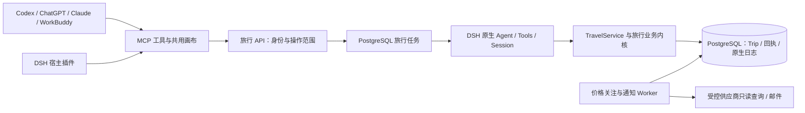

# Plugin App 与 DSH 旅行服务

2026-11-11 补充：工作台已统一采用 React／DSH 和 Turnsu 品牌，新手账、浮雕、沉浸、共享及逐项确认接入同一 PostgreSQL 旅行；设计与数据行为、迁移和验证边界见[统一实现记录](../research/2026-11-11-unified-turnsu-workbench.md)。

更新：2026-11-11。本文承接已确认的产品迭代与架构选择。实现及证据边界见[本轮交付记录](../research/2026-11-11-plugin-app-implementation.md)；本文不代表上线或真实宿主已经验收。

## 用户会看到什么

用户在宿主 Agent 中表达旅行要求，在旅行画布中看完整主方案、比较候选并确认修改。酒店、交通、餐饮和体验共用同一趟旅行。换一家酒店时，先保留其他安排和时间，再核对受影响的路线与预算；核对通过才可采用，采用后可以撤销最近一次仍有效的修改。

桌面 Web 保留对话侧栏；嵌入宿主时沿用宿主对话，不再开第二套聊天。内嵌卡片先展示四域摘要，支持展开完整画布。没有 fullscreen 的宿主可在原容器展开。地图继续复用现有地图、路线与来源展示，不用示意图代替正式数据。

| 界面 | 主要动作与完成证据 |
| --- | --- |
| 主方案 | 草案与已采用安排明确区分；按天展示到访与时间，刷新后仍可读取 |
| 比较 | 住宿展示房型、人数/房数、早餐、退改、位置和设施；交通展示时刻、站点、舱等/席别、行李、退改、换乘。缺失信息标明待核验 |
| 局部修改 | 完整方案每次选择一个替换目标；保留其他站点与时段，经原路线/预算/Checker 核验后采用 |
| 旅行要求 | 直接修改日期、人数、预算和偏好；检查 revision，保留已采用安排并使旧证明失效 |
| 偏好 | 用户主动开启；明确表达可保存，选择推测先确认；可修改、删除、关闭。当前旅行的例外优先 |
| 价格关注 | 未订航班/酒店按相同完整条件查价；暂停、修改、恢复、到期、标记已订或删除；只提醒 |
| 报价核对 | 主动重新查询同条件新报价，条件变化或来源失败不给可用跳转；有效链接仍由用户确认打开 |

长期偏好只取本产品中的表达和选择。邮件地址单独验证，保存在通知服务，不能进入 Agent 旅行事实或会话。关闭偏好后停止新增与自动使用；删除不会改写以前的旅行。

## 一份业务状态、一个后台执行入口

宿主负责用户对话和展示；云端 DSH 执行旅行任务。Travel Parent 仍拥有业务提交门，Skills/Providers 只返回证据或建议。Trip Runtime、路线、预算、锁定项、read set、revision、新鲜度与业务持久化继续复用，客户端不复制提交规则。

新任务使用原生 DSH Agent、AgentLoop、Tools、NativeExecutor、Session、Projection、Checkpoint、TokenMeter 和 Compaction。Pi 模型接入库继续复用；新云端任务不调用 Pi Coding Agent。旧 Pi 完成历史用于重建上下文，不宣称二者的执行日志可以直接互读。

PostgreSQL 同时保存原生 DSH 日志与业务记录。执行权由任务租约和 fence 校验；会话再使用独立 writer epoch，防止相同 fence 的不同任务或迟到 close 覆盖新持有者。业务变更与逻辑操作回执同事务提交，接管时先查实际回执，不能因工具结果丢失就重新执行。图片只留在本次请求内；不能安全恢复的图片任务要求重新附图。

价格关注使用独立的业务表、到期时间和租约，在已有 Worker 中检查；不另加 Goal 或第二套 Agent 调度。通知与邮件待发送记录同事务落库。相同条件、相同价格不会重复提醒；条件变化和来源故障保留最近有效结果。邮件重试复用同一幂等键，超过提供方去重窗口的未知结果停止自动重发。

## 宿主支持边界

Codex/ChatGPT 使用 OpenAI 插件声明与 MCP App；Claude 优先标准交互式 MCP App，Artifact 只在宿主确实提供授权连接器绑定时作为附加适配。WorkBuddy 使用官方 Connector 的 MCP + Skill 包。它们复用同一业务服务和画布。

DSH 云端后端组合与个人宿主 Bundle 均已实现。个人插件补上动态 OAuth/PKCE 授权和自动刷新，官方 MCP client 引用宿主凭据服务中的托管令牌；右侧标签页加载同一份 opaque 旅行画布。有限操作走 DSH owner 接口，再由云端校验用户权限。画布选择进入同一个宿主 Session 的上下文，保存后才确认同步，不额外启动对话。同一旅行服务在一份私有凭据存储中对应一个账户；profile 本身不隔离凭据。

隔离官方 DSH Web 宿主已实际完成本地授权同意页、回跳、侧栏和画布展开/行程读取；使用受控账号与旅行事实。DSH 桌面包、HTTPS 远程回调、真实宿主模型轮次和跨宿主接力仍未验收。具体安装、撤销与信任边界见 [DSH 插件说明](../../plugins/travel-agent-dsh/README.md)。

所有宿主都需要真实安装、OAuth、权限、断开重连、展开画布和跨宿主继续同一旅行的验收。源码、协议检查和本地容器通过，均不等于完成这一步。

## 运行与变更

要求 Node ≥24.9.0，生产使用 PostgreSQL。`npm run api` 启动 DSH 旅行应用；`npm run worker` 使用同一组合执行持久任务和关注检查；`npm run mcp:serve` 为宿主提供 MCP。API/Worker 分离时设置 `postgres_run`，来源和模型能力必须按真实配置报告。

购买、支付、自动退改、社交写操作仍不在范围内。供应商授权、生产登录、邮件域名验证与宿主审核没有完成时保持明确不可用状态。安装、迁移、验证和回退的具体步骤见[交付记录附录](../research/2026-11-11-plugin-app-implementation.md#运行与部署附录)。
