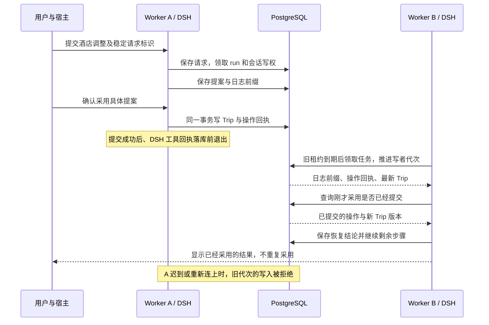

# DSH 后端验证方案：跨实例安全接续

日期：2026-11-11。状态：**保留已确认验证设计，用户后续已授权开发。** 原生 DSH、PG 上游合同与两进程接管已进行本地受控验证；生产/真实来源/宿主仍未验收，详见[本轮实现记录](./2026-11-11-plugin-app-implementation.md)。

## 1. 已确认的目标与本方案要回答的问题

用户已确认目标架构：云端 DSH 统一承载后端应用和内部 Agent，保留旅行业务内核与 PostgreSQL；新任务替换 Pi Coding Agent，各宿主继续使用旅行插件和共用画布。首版要求另一个后台实例能安全接续可恢复任务，不能依赖原实例本地文件或持久卷恢复。

本方案回答：**正在规划或调整的旅行遇到进程故障后，另一个实例能否接着完成，且不丢已保存选择、不重复提交、不串账号？** 这是执行验证的设计，不是验证通过记录，也不是开发或迁移授权。

对应[目标架构评估](./2026-11-11-plugin-app-architecture-assessment.md)和[产品迭代计划](./2026-11-11-plugin-app-product-iteration-plan.md)。后者的主方案、酒店/交通深度、偏好、价格关注及首批宿主范围全部保留；运行时通过不代表这些产品能力已经交付。

评审产品结果与范围，可先读第 1–3、7、10 节；准备实施验证时还需读第 4–6、8–9 节的执行合同和故障边界。

### 本轮已确定的技术路线

- 业务数据和 DSH 会话共享持久化均以 PostgreSQL 为目标。使用现有 `pg`，为 DSH 实现其原生 Session persistence 合同；本地 JSONL 只可用于明确标记的对照，不作为跨实例接管的完成证据。
- 复用现有任务准入、配额、租约、事务写入保护和 Trip 提交规则；DSH 管理任务内部的模型循环，不再建第二套旅行总状态。
- 两个独立 Worker 进程使用各自的运行目录，仅通过 PostgreSQL 共享恢复资料；不能通过共享内存、原实例文件或测试控制器偷偷传递会话。
- 不保证任意中断都无条件自动执行。保留已知事实，先辨明是否可恢复；未知副作用、已撤销权限、过期报价和丢失原图各有明确处理。

## 2. 用同一旅行证明用户结果

受控验收先建立一份有独立预期值的旅行：完整四域安排，航班及一项预约已锁定；用户要求更换酒店，其他选择尽量保留。使用明确标记的日期、报价、地点、时长和证据夹具，单独声明预期成本差与受影响移动段，不能把模型答案或当前实现输出当作正确答案。

用户通过真实旅行 HTTP/MCP 入口提交请求，Worker A 使用原生 DSH 执行。分别在查询、提案形成、业务保存及回执保存附近中断 A；Worker B 从共享数据库接续。最后由一个新的客户端请求重新读取旅行，检查：

1. 同一旅行、同一用户要求仍在，没有重复创建对话、Trip 或用户消息。
2. 酒店选择、报价条件和确认含义正确；锁定航班、预约和无关安排保持。
3. 预算差额与被修改的接驳可解释；不是仅恢复了一段“已经改好了”的文字。
4. 已保存的变更不重复采用；未获用户确认的草案不因恢复而自动采用。
5. 已失效的价格或来源重新核验，旧资料不作为当前可预订报价。
6. 用户在另一已连接宿主中打开时看到同一份最新结果和待处理事项。

受控阶段可以使用脚本模型适配器稳定触发工具序列，但 DSH Agent、工具执行、旅行服务和 PostgreSQL 必须真实运行。此阶段证明运行控制与业务一致性，**不证明模型自主规划、真实价格或供应商可用**。后续再以真实模型、来源和宿主分别验收。

## 3. 明确“可恢复任务”的边界

| 故障时的真实情况 | 恢复动作 | 用户可见结果及禁止行为 |
| --- | --- | --- |
| 输入已保存，尚未调用模型或只完成可重查读取 | B 取得有效执行权后继续；读取结果仅在条件和时效仍匹配时复用 | 不重复用户输入；不复用过期房价 |
| 已有有效提案，尚未采用 | 恢复提案与其校验依据，必要时重查受影响资料 | 仍是待确认草案，不自动采用 |
| 业务变更与操作回执已提交，模型工具回执尚未保存 | 查询操作回执和权威 Trip，重新交付已提交结果，再继续剩余步骤 | 不重做同一业务变更，不要求用户重复确认已完成的同一操作 |
| 操作已准入，但可证明其业务事务未提交，原确认仍有效 | 按同一逻辑操作标识安全执行；重新检查版本、锁定项和报价 | 条件改变时重建预览，不能沿用失效确认 |
| 操作结果不明，或者旧实现没有足够回执可判定 | 先回查；仍无法建立结果则暂停该副作用，保存旅行并请求必要核对 | 不把超时当作失败后自动再写；不暗中切到 Pi 重跑 |
| 等待用户回答，或等待模型/供应商配额 | 保留问题/等待条件并释放 Worker；从相同事实版本接续 | 旧答案不能覆盖新要求，配额等待不占住空转 Agent |
| 用户已经取消、任务到期、权限撤销 | 不自动恢复执行；保留可查看的合法结果 | 不因另一个实例启动而重新激活 |
| 需要本次请求原图，但 A 已退出且原图未持久化 | 保留文字、已保存结果与待决事项，明确要求重新附图 | 不从磁盘、日志或其他用户缓存取回；不编造图片观察 |
| 云端已提交但客户端没收到响应 | 同一请求标识查询原结果 | 不把客户端重试当作新命令 |

“安全接续”允许有明确的待确认/待补资料结果。它不意味着自动重放所有工具，也不意味着恢复同一段尚未持久化的模型字节流。

## 4. 共享持久化与执行权合同

本节是拟议验收合同，不是当前已有字段或数据库迁移。具体表名可按现有 repository 风格确定；下列语义必须保留。

| 标识/字段 | 含义和拥有者 | 必须区分的对象 |
| --- | --- | --- |
| `requestId` | 客户端一次逻辑请求的去重标识；服务按账号、对话及内容摘要校验 | 同键不同内容必须冲突，不能返回旧成功 |
| `runId` / `runFence` | 服务持久任务及该任务的有效执行代次；复用现有 run/fence 机制 | 同一 run 的旧 Worker 不能继续写或报告成功 |
| `sessionId` / `writerEpoch` | DSH 会话及其单写者代次；由共享持久化适配维护 | 多个 run 可顺序使用同一会话，不能只用每个 run 自己的 fence 判断会话所有权 |
| `activeRunId`、执行者与租约 | 将会话写者绑定到已获准的任务和 Worker | 会话 lease 附属于业务准入，不是第二个独立调度器 |
| `durableEventCount` | 已确认持久化的日志前缀长度；0 表示空，N 表示 `seq=0…N-1` | 不是 UI 进度、模型 token 数或 Trip 版本 |
| 日志格式版本/后端 revision | 原生 DSH 格式和后端变更观察值 | 不与 Trip revision、存储 CAS 或写者代次混用；单纯换 owner 不应伪造日志变化 |
| `operationId`、输入摘要与提交回执 | 服务为一次逻辑业务变更分配并持久保存的身份和结果 | 不能仅依赖模型重试时新生成的 tool-call ID |
| Trip revision / storage version | 业务规则版本与数据库条件更新版本，沿用现有语义 | DSH 日志已落库不代表 Trip 已采用 |

### 4.1 任务和会话写者必须一起受控

- 领取、续租和接管以 PostgreSQL 的时间与事务结果为准。实例本地时钟可以用于显示或诊断，不能让快/慢钟绕过执行权。
- 接管会推进会话写者代次，并把它绑定到新 run 执行代次。读取可以并发，写日志和提交业务必须验证各自的有效代次。
- 旧 A 即使恢复网络、拿到迟到模型响应或执行旧 `close()`，也不能追加日志、覆盖结果或释放 B 的写权。关闭/释放必须按原 owner 与代次条件生效。
- DSH 工具必须带有明确的用户、旅行和执行身份。不能依赖异步上下文恰好存在；缺少该身份时拒绝 Agent 写入。普通用户直接编辑仍走自己的鉴权和版本校验路径，不能混作无身份 Agent 写入。
- 同一 Trip 上的新用户编辑和恢复任务继续遵守读取集、写入合同及锁定项检查；恢复不拥有覆盖用户最新选择的特殊权限。

### 4.2 日志后端需满足原生合同，而非保存一个 JSON 快照

复用固定 DSH SHA 的 `runPersistenceContract` 与 `runLiveWritePathContract` 作为上游行为依据，并补齐跨进程/租约验证。它们位于上游源码测试目录，不假设发布的 npm 包能直接导入；验证时在审计后的隔离 checkout 运行上游套件，或在项目现有 `node:test` 中实现对应行为断言，不为此改造全仓测试框架。

必须证明：

- `create/open/read/append/flush/close` 的真实行为，连续序号、只追加、同实例可见性、其他实例重新打开后的正确前缀，以及只读/关闭句柄拒绝写入。
- 新建但未实体化的会话与数据库中的 owner 预留记录分开；不能因预留一行就违反上游的空会话可见性和关闭语义。
- 已确认的 flush 在进程强杀后仍可由 B 读取；flush 失败不返回“已保存”。后台写入失败不能被吞掉。
- 追加响应丢失时重新核对已提交前缀，不盲目重复 INSERT 或用 `ON CONFLICT DO NOTHING` 吞掉同序号不同内容。
- 未知/更高格式版本、无效事件和不连续序号明确拒绝；不丢弃不认识的内容后假装恢复成功。
- 会话实时事件确实进入对应写句柄，原生 `session/flush`、会话关闭和插件卸载会排空相应写入。

上游套件中重开能力不能因未提供 `reopen` 而跳过后仍算本方案通过；文件撕裂尾部用例与 PostgreSQL 原子事务不同，应明确“不适用”，并用提交前/后断连验证数据库边界。上游同实例单写者测试不能代替两个真实进程竞争。

依据：[原生句柄合同](https://github.com/deepseek-ai/deepseek-harness/blob/fcc0ad462172522aaf5c93a7b2e01f6b9f0b0159/packages/session/session-persistence/src/handle.ts)、[持久化合同测试](https://github.com/deepseek-ai/deepseek-harness/blob/fcc0ad462172522aaf5c93a7b2e01f6b9f0b0159/packages/session/session-persistence/tests/contract.ts)、[实时写入测试](https://github.com/deepseek-ai/deepseek-harness/blob/fcc0ad462172522aaf5c93a7b2e01f6b9f0b0159/packages/session/session-persistence/tests/live-write-contract.ts)。

### 4.3 业务提交和 DSH 工具回执可以分开，但结果必须能回查

业务提交使用已有 PostgreSQL 事务边界，验证当前 run 执行权及 Trip 条件，并在**同一事务**保存变更与其操作回执。DSH 的模型日志随后记录工具结果；不要求把整个模型步骤与业务事务绑定成一个长事务。

不能跨网络查价或调用模型时持有业务事务锁。接管必须与有效写事务串行：已获准的事务先明确提交或回滚，B 才取得新执行代次；事务超时和失联连接的释放也要验证，避免 A 的悬挂事务永久阻止恢复。

`operationId` 在首次准入时分配并保存。恢复不能换一个标识把同一变更当成新操作。只有所有相关业务写入均与回执原子保存，才能由“没有已提交回执”判断未提交；旧实现没有此保证时，回执缺失不构成安全重放证据。

## 5. 一次典型故障的接续顺序



若没有足够证据判断提交，流程停在“回查/需核对”，不能走到重复采用。图中用户确认也必须已经明确关联提案与版本，不能用一条泛化的“继续”代替。

## 6. 故障注入场景与必须看到的证据

只在测试进程、测试库和显式测试适配器中设故障点，不给生产接口增加强杀或任意 SQL 能力。故障点应设在已经观察到某个持久结果之后；不能凭固定 sleep 猜测进程执行到哪里。

| 场景 | 如何制造真实边界 | 通过标准 |
| --- | --- | --- |
| A 强杀、B 接管只读任务 | 观察 A 原生 DSH 模型/工具开始，强杀 A；B 不访问其目录 | B 从 PostgreSQL 恢复同一任务；一个用户请求、一个 Trip；读到最后确认持久前缀 |
| A 暂停而非死亡，B 已接管后 A 恢复 | 暂停 A 的续租/执行，待 B 获新代次，再释放 A 的迟到模型/工具返回 | 只有 B 能追加/提交；A 不能发布迟到成功或覆盖新画布结果 |
| 只有租约过期，B 尚未领取 | 在下一次写入前使租约失效 | A 的新写入被拒绝；不能以“尚无替代 Worker”为由继续写 |
| 同一会话跨多个 run | 正常结束一项任务，下一 run 获会话写权；释放前一 run 的迟到关闭/写入 | 不碰坏新 run 的日志与写权，不能因两个 run 的 fence 恰好相同而误放行 |
| 业务提交前退出 | 在事务前或未提交事务中强杀 A | 未提交变更与回执一起不存在；符合条件的操作由 B 安全继续 |
| 业务已提交、工具回执未保存 | 观察同事务 Trip 和操作回执提交后阻断后续日志并强杀 | B 交付原结果；Trip 只变化一次，没有重复采用 |
| 业务提交响应丢失 | 在客户端收到数据库确认前切断连接，覆盖实际提交/实际回滚两种结果 | 依据数据库回查分类，不按网络错误猜结果 |
| 原生 append/flush 断连 | 分别在确认持久化前后断连/强杀 | 已确认前缀不丢；未确认状态不假报成功；没有日志序号空洞或被吞掉的冲突 |
| 数据库暂时不可用及悬挂事务 | 限制测试连接；保持 A 未完成事务，再触发可控超时 | 无有效执行权时停止写；数据库恢复后才接管；不会无限占锁或转本地 JSON 冒充成功 |
| 时钟偏移与同 Trip 并发 | 只改变测试进程时钟，不改机器时间；另一客户端同时改预算/人数或酒店 | PostgreSQL 执行权不被偏移绕过；旧提案重新核验，用户新选择不丢 |
| 取消、过期与持久等待 | 另一 API 实例取消；分别在模型等待、保存问题及配额等待时中断 A | B 不复活已取消任务；问题/等待可接续且不占空转 Worker；旧答案和重复答案有确定结果 |
| 两账号与权限撤销 | 通过真实 API/MCP 读取、写入、重连事件、恢复其他账号标识；运行中撤销/改变归属 | 全路径拒绝越权；恢复时重新核验归属，不能信旧 run 内存身份 |
| 原图与工具权限 | 带测试图分别正常结束、取消、强杀；Parent/Child 尝试未允许工具 | 持久库、日志和各运行目录不含原图或其规范化/路由派生图片，也不保留可绕过授权读取的引用；不能只扫描原文件哈希；无图则要求重附；Shell/安装插件/Child 提交不能执行 |
| 模型限额与压缩 | 在 Parent、Child、压缩和重试处耗尽配额或中断，恢复后继续 | 每次实际请求受预算控制；旧报价不因压缩变成当前事实，任务不因模型停止而被记为成功 |

跨实例恢复的受控目标：PostgreSQL 可用且有可用 Worker 时，从 A 故障到 B 开始恢复，沿用现有进程测试的 **60 秒以内**目标。记录失效、领取和日志恢复就绪各时间点；这不是上线 SLA，也不代表模型回复或供应商查询能在该时间内完成。无可用容量、数据库失联等情况应记录等待原因，不能从统计中无说明地排除。

## 7. 最小验证环境与真实性分层

### 受控环境

采用现有测试风格：一个 API 进程、Worker A 与 B、一个隔离 PostgreSQL 测试库。使用不同 `DSH_HOME`、不同进程及独立数据库连接；只共享服务代码和测试数据库，不共享会话文件。每次测试使用独立 schema，守卫目标数据库和归属，清理仅限测试创建的资源。

固定 DSH SHA、依赖锁、许可/写面审计及 Node 版本。安装阶段按项目要求隔离、无凭据并禁用安装脚本。模型与供应商的 fake 必须明确命名、依据合同且覆盖错误；验证报告逐项列出哪些依赖真实、哪些模拟。工具序列来自脚本模型时不得宣称已证明模型自主选择正确。

### 按依赖放行，而非一次运行整个产品

| 阶段 | 实际要证明的结果 | 放行后的允许结论 |
| --- | --- | --- |
| V0 · 专用组合与共享存储 | 固定依赖、白名单工具、原生 persistence 合同、双实例数据可见性及跨进程单写者 | 可以进入原生执行故障验证；不等于旅行任务可恢复 |
| V1 · 原生执行与提交接续 | 真实 DSH Agent/工具/旅行服务/PostgreSQL，覆盖第 6 节的关键故障点；上游模型与旅游资料可明确模拟 | 可说明在已测边界内运行和业务一致性成立；不宣称真实规划或供应商通过 |
| V2 · 真实模型与业务资料 | 用实际模型完成主路径；核验真实酒店房型/退改与交通票规、来源、新鲜度和预算；故障后再继续 | 证明相应模型/来源组合的可用旅行结果；不等于所有目的地、所有负载都通过 |
| V3 · 宿主与完整产品 | Codex/ChatGPT/DSH 各自安装、连接、主路径、跨宿主再打开及实例故障后的恢复；Claude/WorkBuddy 按既定适配范围独立记录 | 只对实际测试的宿主/版本/账号形态声明支持 |
| V4 · 长期能力 | 实际使用偏好、关闭所有宿主后查机酒价格、站内及验证邮箱收到提醒、暂停/到期/重试正确 | 长期偏好和关注可按产品计划交付；不是原生 Schedule 入队成功 |

V0/V1 是后端迁移放行条件；V2/V3 和完整产品路径决定用户交付。V4 不被本验证计划删掉，也不为验证执行器先造一整套关注平台。产品和 UI 的独立深化可继续；验证发现问题只暂停依赖它的迁移步骤。

## 8. 价格关注和邮件的故障结果

关注任务用业务表领取到期对象，价格匹配不依赖模型自由判断。重复执行不能重复生成同一目标价事件；站内消息与邮件待发送记录同事务保存，各渠道结果独立可见。原生 Schedule 收件回执不能作为查价或邮件证据。

除正常降价外，至少验证：同房型但早餐/退改变了、只剩一间房、舱等/行李改变、来源失败、暂停/截止与领取竞争、投递前后进程退出。条件不可核实时不发达标消息，不把缓存当新报价。

“邮件请求超时”可能已经发送。只有邮件服务提供可用的幂等标识或回查结果，才允许据此安全重试并声明不重复发信；若无法判断，保存为待核对并停止盲目重发。数据库唯一通知事件不等于外部邮箱一定只收到一次。未来真实验证使用明确授权的测试邮箱，本轮不发送邮件。

## 9. 复用入口、必要增量和命令说明

### 已有源码与测试可直接作为基线

- `src/persistence/execution-write.mjs` 在同一 PostgreSQL 事务锁定 run 并执行业务写入；`postgres-trip-repository.mjs` 沿用版本条件保存。应适配复用，不能换成只在工具开始前检查一次权限。
- `execution-repository.mjs` 已有请求去重、任务租约、fence、配额、持久问题及有限恢复；现有只读恢复条件不能当作 DSH 新行为已完成。
- `tests/travel-execution-postgres.test.mjs` 已覆盖独立连接池、取消、旧写者、配额、有限只读恢复与不明写入不重放等场景。
- `tests/travel-execution-process.test.mjs` 和 `tests/fixtures/execution-worker.mjs` 是真实强杀进程与事件权限的基线，但当前使用 Pi/受控模型，不能改个报告名称就算 DSH 通过。
- `tests/travel-execution.test.mjs` 中的图片、问题、压缩与等待语义需要在新执行路径上保留。

### 将来实施验证时才新增的内容

- 严格 TypeScript 的 DSH PostgreSQL persistence 与专用旅行执行组合。
- 在现有 Node 测试框架增加 persistence/接管用例及原生 DSH Worker 夹具；上游 Vitest 仅在隔离源码验证需要时使用。
- 业务变更操作标识与原子回执、会话写者代次及与 run 的绑定；具体字段/迁移由已有数据拥有者实现。
- 受控故障点用于杀进程、延迟返回、断开数据库及检查持久结果；仅测试可用，不引入生产通用故障控制服务。

既有基线命令如下，**本轮没有执行**。运行前必须设置并核验 `TRAVEL_EXECUTION_TEST_DATABASE_URL` 指向隔离测试库；没有该变量时，现有 PostgreSQL/进程测试会 skip，不能把退出码 0 报成数据库通过。

```bash
node --import tsx --test tests/travel-execution-postgres.test.mjs tests/travel-execution-process.test.mjs
```

这条命令目前验证已有 Pi 基线，不包含尚未创建的 DSH 夹具。新增路径先运行对应聚焦检查；共享后端/Runtime 交付时按项目路由运行 `npm run check` 等受影响检查。不为本方案自动构建所有小程序、复制 Capacitor 或跑无关端验收。

## 10. 记录什么，何时算完成

执行后使用一份验证报告及可复查产物，不另建状态平台。每个场景记录：起始条件、真实入口、故障位置、运行版本、真实/模拟依赖、期望和实际用户结果、数据库重新查询、执行代次与日志前缀、接管时间及未覆盖边界。身份标识使用测试值，凭据、原图及 access-bearing URL 不进入产物。

判定以持久结果和用户结果为准：Trip/用户消息/操作回执不重复，旧代次写入确实被拒绝，已确认日志前缀可重读，越权入口确实拒绝，发生等待/需重附图时界面解释清楚。不能用工具函数调用次数、进程重启成功、测试数量、截图数量或模型宣称完成替代这些结果。

对高价值断言做有针对性的反证：例如在隔离副本临时撤掉旧代次校验或提交回执去重，确认相应场景会失败；不做无关全仓 mutation testing，也不把破坏性逻辑带进正式实现。

放行时分别说明：哪些运行时条件通过、哪些真实业务资料通过、哪些宿主通过、哪些长期能力通过。任一关键隔离、图片不留存、重复写或恢复一致性条件未成立，就不切换其相关写入路径；保留旧部署作为明确对照/回退，不静默双执行。

**当前事实：仅完成验证设计及源码核对，以上验证均未执行。** 下一步可以据此评审验证实施范围；本次确认不启动开发、依赖安装、供应商请求、邮件发送、数据库迁移或生产部署。
