# Odessia 深度研究：产品能力、UI/UX 与技术依据

研究日期：2026-11-11（香港时间）。对象：Odessia 收购前公开产品，以及 Travel Agent 当前本地工作区。本文用于产品判断，不构成开发授权，也不是双方产品的成功率排名。

## 先读结论

Odessia 的产品价值来自几件事相互配合：理解旅行者、取得可购买的选择、用旅行专用控件帮助选择、把选择保存在同一旅行中，并在合适时机继续服务。它的交互研究价值，比“能生成完整攻略”这个描述大得多。

对我们最有用的启发，是把 Agent 的判断变成用户可以检查和直接操作的旅行对象。当前我们已经有地图、候选、问题卡、试排、确认和恢复基础，接下来应重点验证这些能力是否持续围绕同一目标工作，是否把已有信息正确交给下一个界面，而不是继续增加入口。

这轮出现了四项会改变上一轮判断的新证据：

1. 产品演示能直接看到按任务切换的地图、旅行清单、酒店比较、房型和付款界面；因此可以研究具体信息结构，不能只按聊天机器人来理解。
2. 演示中的“加入旅行”与最终购买分开；付款画面还明确排除了一家无库存酒店。不能将演示到达结账页表述为已成功预订整趟旅行。
3. 一份停服前的独立单场景测试记录了外部结账跳转，说明其履约方式随渠道和供应商而异。
4. 技术分享明确涉及工具设计、LangGraph、LangSmith、运行轨迹和评估；其中所谓 synthetic NPS 是模型估计的满意度，不是实际用户 NPS，也不能证明旅行事实正确。

## 证据范围与阅读方法

官网现已显示收购及停服公告。本轮不能新建 Odessia 账号、实际改行程、检查支付结果或验证通知送达。我们使用公开演示逐帧观察、当事人技术分享、服务条款的搜索收录，以及独立使用记录。官网已下线的内容只能按历史资料使用。[当前官网](https://odessia.com/)

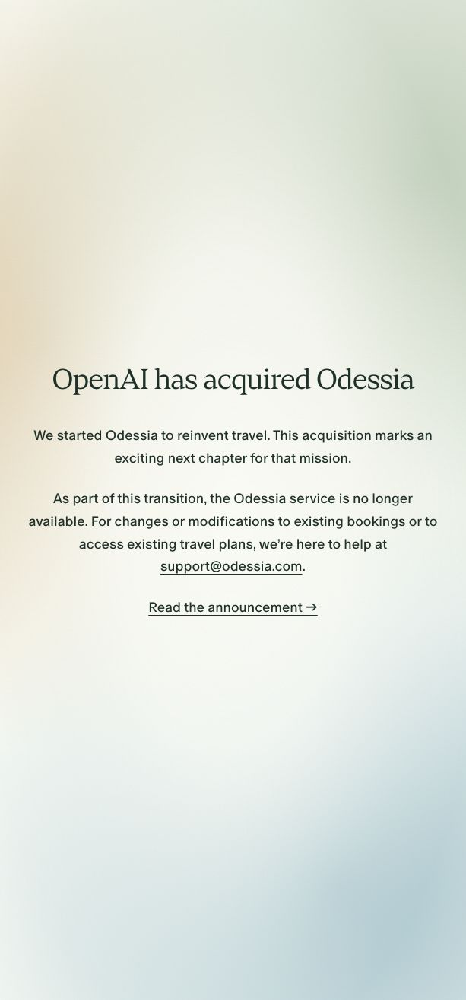

本文使用以下证据标记：

| 标记 | 含义 | 可以支持的结论 |
| --- | --- | --- |
| 演示观察 | 本轮取得公开视频，并检查对应时间点的原始画面 | 页面结构、演示中的动作与可见反馈；不证明后台真实或普遍可用 |
| 一手说明 | 公司、创始人、技术合作方的说明或条款 | 对方承诺或披露了什么；不当作独立验收 |
| 独立记录 | 使用者或研究方记录自己的操作 | 该版本、该场景的结果；不外推总体表现 |
| 当前源码 | 本轮直接检查我们工作区源码 | 现在有什么代码及接线；不等于真实平台验收 |
| 分析推断 | 从上述资料推导产品含义或必要能力 | 借鉴与决策参考；不冒充对方内部架构 |

**版本限制：** 墨西哥城演示、新西兰酒店比较、洛杉矶升级演示和十月宣传片并非一份固定版本的连续验收。不同视频的布局、评分和日期不能拼成一个已经证实的生产版本。下文的步骤编号用于组织研究，跨视频部分会明确标注。

## 一、产品能力：它在持续替用户处理什么

### 1. 单次规划、决策与长期服务是三种不同工作

从演示看，单次旅行的用户可以先找活动，再让 Agent 补酒店和航班；已有选择保留在右侧旅行清单中。这里的价值是连续完成一件事：后来的酒店需要服务于已有活动，晚到的航班也需要重新检查首日安排。[墨西哥城演示](https://x.com/FDavidsonT/status/2064754470911959505)

十月发布说明则增加长期偏好、邮箱导入、周期监测和多人共享。它把使用理由扩展到两次旅行之间：关注生日餐位、未来假期和价格机会。**分析推断：** 这有助于降低低频旅游产品的重新获客和重复介绍成本，但真实留存提升没有公开证据。[十月发布说明](https://www.linkedin.com/pulse/introducing-odessia-francis-davidson-gkw8c)

洛杉矶演示进一步展示“指定两家酒店，同时寻找更适合的其他选择”这一任务。它比开放式推荐更接近日常决策：保留用户听说过的参照物，再解释为什么推荐另一个价格或房型。[洛杉矶升级演示](https://www.linkedin.com/posts/francisdavidson_watch-me-use-ai-to-book-a-trip-to-la-in-2-activity-7481075060032552960-Jfyc)

### 2. 能力之间的依赖关系

下图是根据公开行为整理的**功能关系图**，不是披露其数据库、服务部署或调用协议。

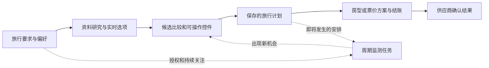

图中的关键不是 Agent 数量，而是每次接续是否仍使用同一组日期、同行人、偏好和已经选中的安排。供应商确认结果与“加入计划”是两个不同的完成点。监测任务如何物理实现、是否与聊天运行共用调度器，公开资料没有说明。

### 3. 真正需要区分的产品对象

以下是依据行为进行的对象分析，不是对方实际数据库表名。

| 对象 | 用户需要理解的内容 | 混淆后的后果 |
| --- | --- | --- |
| 用户偏好 | 本人明确要求、系统推测与本趟例外 | 历史喜欢奢华酒店，不代表此次商务预算可以突破 |
| 地点或酒店 | 在哪里、适合谁、优点与缺点 | 地点推荐正确，也可能没有指定日期库存 |
| 可购买报价 | 日期、人数、房型或舱等、税费、取消条件 | 同酒店的低价房不能替代已选的可退早餐房 |
| 旅行安排 | 先后顺序、时间、关联交通和是否已选 | 收藏了地点，不代表已经排进某一天 |
| 监测任务 | 关注对象、时间范围、频率、通知或操作授权 | “提醒我有空位”不能自动升级为“付钱订下” |
| 预订结果 | 哪个供应商确认、实际金额与后续服务渠道 | 结账页、购物清单或聊天承诺被误当成订单 |

这些区分与我们现有 Evidence、节点、到访、报价和 TripPatchProposal 相容。后者是“待确认的行程修改提案”，用于把建议与实际状态变化分开；不需要因竞品研究再建立另一份旅行状态。

## 二、UI 与 UX：按画面还原任务流程

### 步骤 1：用小型决策控件缩小旅行范围

**演示观察：** 墨西哥城视频先询问从什么任务开始、谁同行，再以选项卡片询问兴趣、节奏和预算风格；可以自由输入、跳过或退回。下图是 00:28 的预算风格选择。

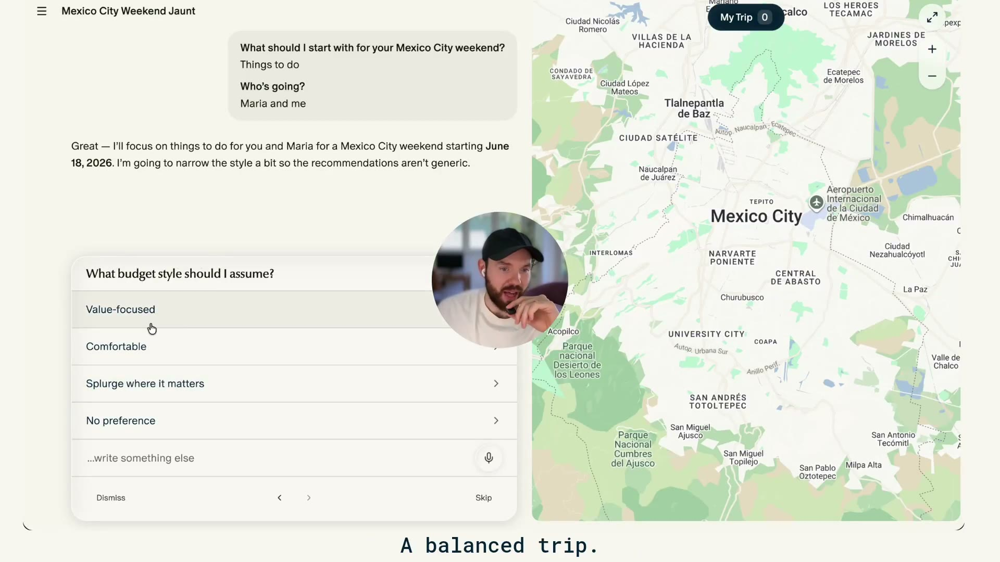

**分析：** 这是对开放输入的补充。用户用短选择表达偏好，系统再承担把偏好转成搜索条件的工作。预算“风格”仍然不能代替明确金额上限；如果后续会付款，必须把预算、人数和固定日期收敛成可检查事实。

**对照我们：** 我们已有带选项和影响说明的问题卡，而非完全缺少结构化交互。当前需验证的是何时提问、答案是否被接续消费，以及已提供的条件会不会被重复询问。[当前问题控件](../../src/web/execution-progress.jsx)

**风险边界：** 公开发布说明下有使用者报告，系统过早假定出发地和同行情况，导致反复改方案。这是一条个案反馈，不能当作普遍发生；它提醒我们，不要因为演示流畅而省掉关键事实确认。[发布说明中的使用反馈](https://www.linkedin.com/pulse/introducing-odessia-francis-davidson-gkw8c)

### 步骤 2：候选是能操作的对象，而非答案里的名词

**演示观察：** 推荐中有图片卡、价格、评分、地点与可用性入口。酒店搜索可以看到结果总量、价格或评分筛选及地图价格标记；收藏与详情入口分开。

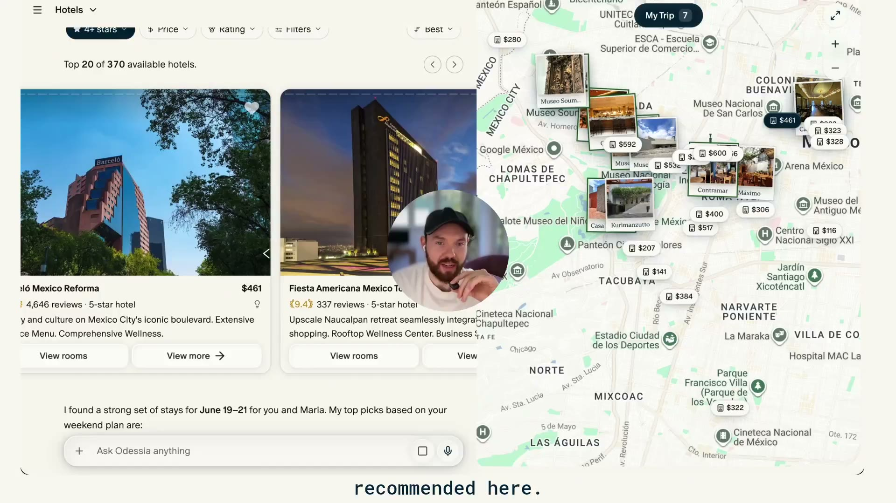

**分析：** 照片回答“想不想去”，地图回答“放在这趟旅行是否方便”，报价回答“是否值得继续比较”，控件让用户不必重新描述选择。这比单纯把文字生成得更短更快更重要。

该帧地图也有明显拥挤：价格标签与地点图片重叠，列表横向移动后出现卡片裁切。它展示了内容丰富，但不能据此判定地图交互已经优秀。我们应学习列表与地图的关联，不能照搬同时铺满所有标记的密度。

### 步骤 3：把已选安排持久呈现，暴露尚未补齐的位置

**演示观察：** 右侧可以从地图切换成旅行清单。清单包含逐日安排、航班和住宿缺口、已选项目、汇总与继续预订入口；聊天仍然可以使用。

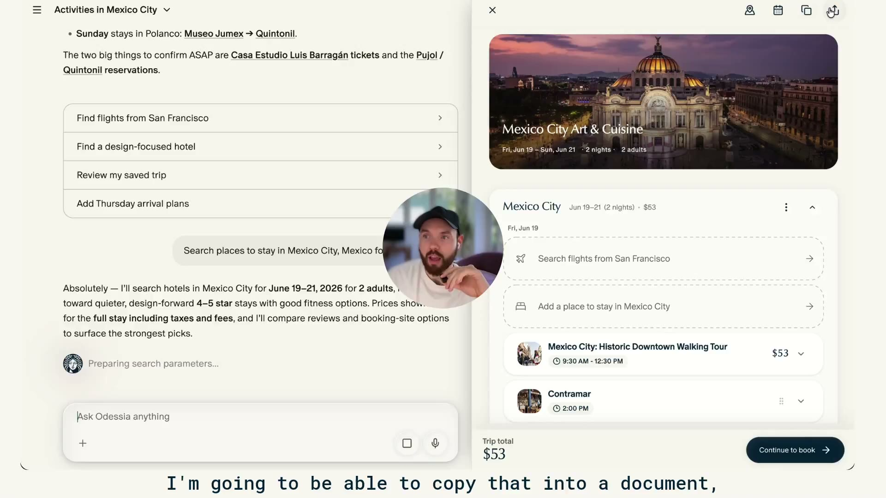

**分析：** 它让“刚才聊出来什么”变成可见状态。缺航班和住宿时，不必回读聊天寻找下一步。地图、清单和详情占用同一工作区，可理解为根据当前任务更换查看对象，而不是把全部功能固定铺成多栏。

清单在部分时刻还有“任意时间”项目和未补齐的天数，因此“旅行清单已保存”仍不能证明时间与交通可执行。界面上的地图、日历、复制、分享图标也只能证明入口存在；本轮没有完成其具体操作。

**对照我们：** 当前 `PlanCanvas` 已有日期、同行人、预算入口，以及发现比较、行程路线和手账视图。日期等入口主要把修正句子放回聊天输入，并非字段内直接编辑。这是具体的操作成本差异，不应误报成我们完全没有旅行摘要。[当前工作台](../../src/web/travel-app.jsx)

### 步骤 4：酒店详情首先帮助判断，再进入房型购买

**演示观察：** 详情左侧保留其他酒店，主区提供图片、适合本人的理由和具体特色，再提供房型或入住日期入口。下面是墨西哥城 03:00 的酒店详情。

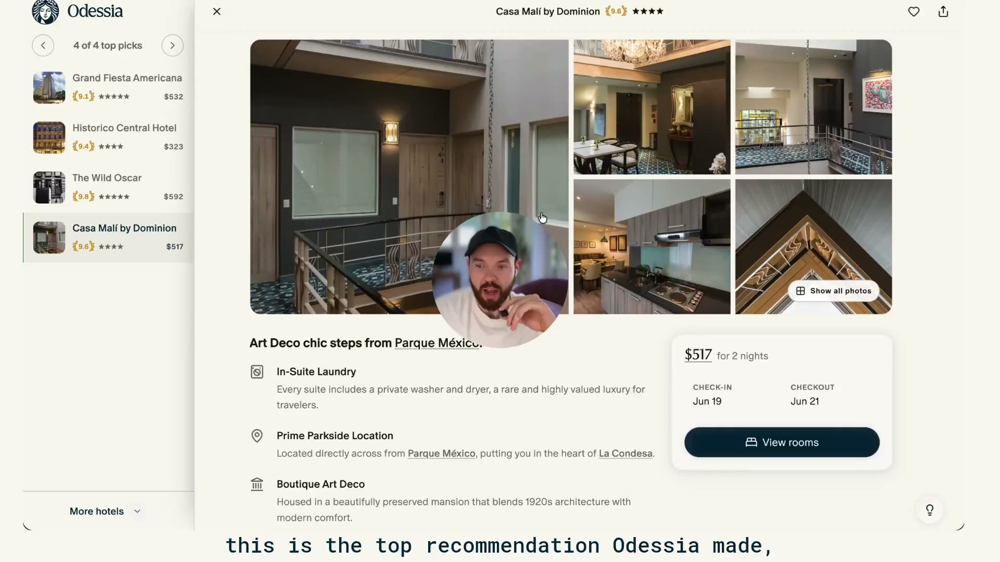

**分析：** 左侧保留替代项，减少“看完详情后从头找”的成本。详情先解释为什么适合，再引导购买，把理解商品与确定交易方案分成两步。这里的产品资产是经过组织的比较维度、适配理由及其来源，图片风格本身较容易复制。

公开酒店报告确实展示独立维度及综合分，但本轮没有验证评分来源完整性、权重、更新频率或预测效果。早期演示的分值形式与后续报告不同，不能混成一套已知算法。[公开酒店报告样例](https://odessia.com/hotels/hong-kong/hong-kong/burlington-hotel)

### 步骤 5：同一酒店的房型和价格条款单独选择

**演示观察：** 新西兰比较视频 00:42 展示多个房型、整段住宿总价、每晚价格、早餐和退款标记，选择房型后再进入结账。

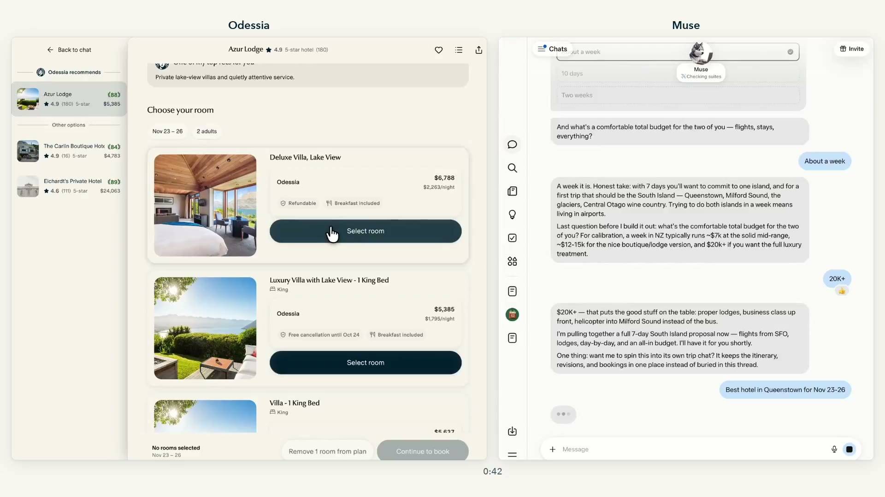

**分析：** “推荐这家酒店”之后仍然有关键决策：哪个房型、哪种取消政策、什么价格。用户确认酒店，并不等于授权 Agent 换成最便宜但不可退的方案。

同一组画面中，列表起价与选中房型总价不同。系统应清楚解释变价原因，保留日期、人数和条款，不能只依靠漂亮的价签。我们现有 Provider 能保留部分房型及退改字段，但这与已经完成跨报价的房型比较体验是两回事。

### 步骤 6：结账明确哪些项目不在此次付款中

**演示观察：** 新西兰比较视频 00:54 的付款页单独列出一家不可用酒店，注明不预订、不计入付款；其余酒店按房费、税费、总额展示。页脚画面写有 Nexion 旅行代理标识。

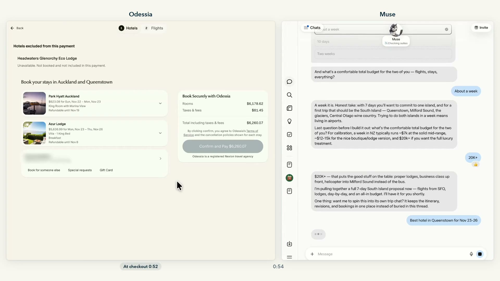

**分析：** 这比模糊地称“整趟已准备好”更可信。某项目失效时，用户能知道此次会付哪些、哪些仍需解决。但本轮没有付款，也没有供应商订单回执，故不能确认多酒店交易是否支持原子提交、部分成功恢复或自动退款。

Nexion 标识是画面证据，不足以确认完整代理资质、合同范围或收购后权益归属。也不能因为网站宣称 IATA 登记，就认定其所有机票均自主出票、全部酒店均直连。

### 步骤 7：行程汇总需要区分“已报价项目”与“全程预算”

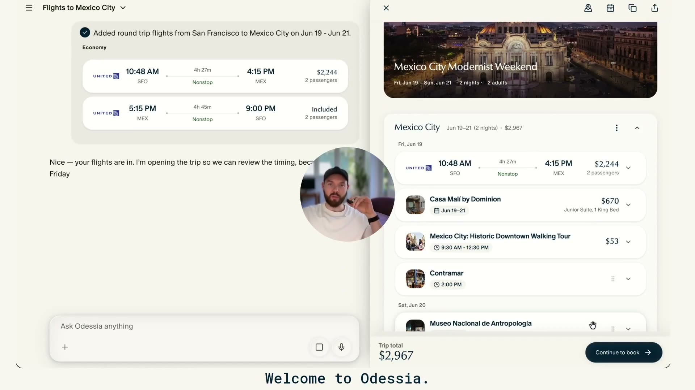

**演示观察与算术核对：** 此帧总额 2,967 美元，恰等于航班 2,244 + 酒店 670 + 步行活动 53。餐厅虽在清单中，画面没有证明餐费、市内交通及其他现场费用进入总额。

**分析：** 可以把它理解为已报价项目的小计，不能从该帧推导出完整旅行预算能力。我们已经把餐饮、次数和市内移动估算纳入预算判断，应该保留这个产品目标，同时明确参考价、估算、已报价和已支付的区别。此处只能比较产品口径，不能认定我们计算得更准确。

### 步骤 8：多人共享和后台关注是新任务，不是装饰功能

十月宣传片展示多人光标及共享计划，也展示持续关注项目与餐位。它们说明产品希望支持共同决策和主动服务；宣传动画不构成编辑冲突、通知可靠性或自动预订成功的证据。

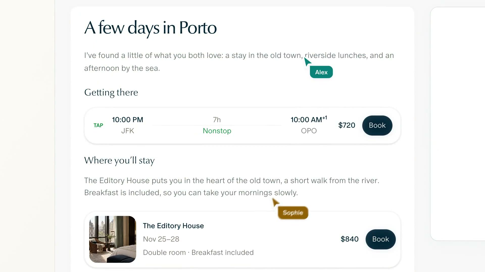

**分析：** 共享计划需要说明谁能改、修改了什么、谁确认；监测需要说明关注条件、停止方式以及出现机会后是通知还是执行。多人光标与周期检查标签不能替代这些行为。我们已有成员和逐人约束基础，还没有据此证明完整共同编辑和长期监测体验。

### 视觉语言与信息层级

补充检查了洛杉矶升级演示：航班行内同时出现现金和积分选择；酒店建议最后附上可直接加入、查看房型、比较报价等下一步。这体现了“先解释取舍，再给能执行的选择”，比只增加文字推荐更接近决策助手。

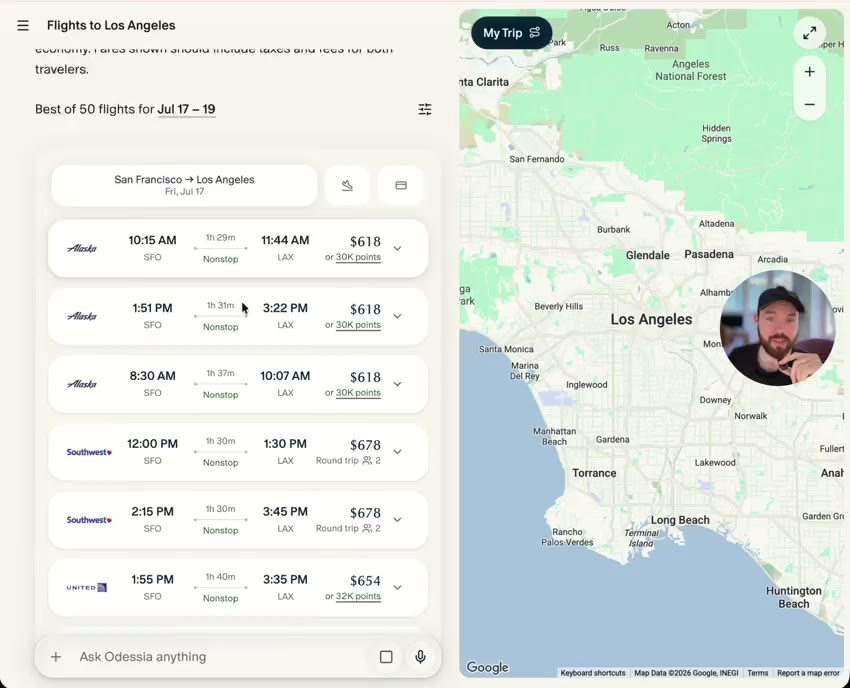

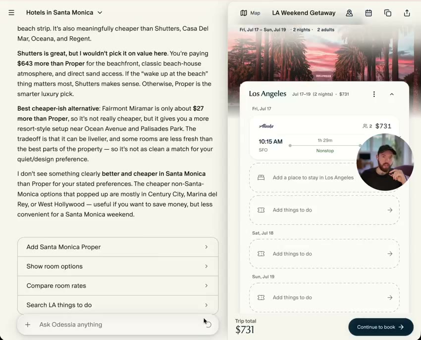

这两张画面裁去了浏览器地址栏，保留产品内容。它们不能证明积分价格、税费和兑换可用性正确，也不能证明最终付款成功；我们没有据此建议加入自动购票。

从上述原始画面可以观察到：大面积暖白底色、深蓝绿色主操作、照片主导的候选，以及标题与正文的字体区分。它用少量稳定颜色突出选择和继续动作；酒店详情比聊天承载更多密度，结账则收敛到价格和承诺。

**可迁移的原则：** 把空间与密度留给当前决策；让候选、已选、尚缺、可购买和已预订的状态可辨；在详情中保留返回比较的上下文。不能通过换配色、加大圆角或复制宣传文案获得同样效果。

**可见风险：** 个别画面的浅灰状态文字较弱，地图重叠较多；图标有无可访问名称、键盘顺序、焦点恢复和触屏命中范围均未验证。视频无法支持 WCAG 合规结论，也无法证明其完整移动网页已经可用；iMessage 宣传片与独立原生应用不是一回事。

## 三、真实体验反证：不把发布演示当作平均表现

SKY VC 在 2026-10-19 用同一往返航班请求测试多个产品，11 月 5 日发布记录。Odessia 首次结果不到 90 秒，初始给一个选项，需要追问才给更多；到付款入口约 6 分 25 秒，跳到外部网站，测试没有付款。仅一个场景，无法推导平均时延或成功率。[测试原文](https://www.sky-vc.com/blog/who-owns-the-booking-moment-we-put-personal-ai-agents-to-the-test)

这会改变两个产品判断：第一，研究中要分别衡量首次有用结果、可比较结果、可结账和真实确认的时间；第二，推荐一个主选可以降低负担，但替代方案必须容易取得。只报告“几十秒出结果”，会掩盖用户仍需操作的后半段。

8 月的一篇创始人采访还记录了日期修改没有正确更新等问题，并描述当时的购买仍需用户验证及最终点击。它早于十月条款，不能用它否定后续版本；同样，后续条款允许的范围也不能倒推成早期已经可用。[采访](https://www.inc.com/georgia-fearn/after-sonders-collapse-its-founder-is-trying-to-engineer-failure-out-of-his-next-startup/91382714)

因此，宣传、条款、真实使用和供应商确认应分别判断。同一个品牌可以同时存在内部酒店结账、航班外部跳转、暂不可用的供应商，以及尚未验收的后台动作。

## 四、技术研究：已知机制、必要推断与未知

### 1. 可以确认到什么程度

| 技术方面 | 当前能确认的依据 | 不能顺势推导的内容 |
| --- | --- | --- |
| Agent 编排 | LangChain 官方说明使用 LangGraph 与 LangSmith | 不知道图的节点、子 Agent 数量、数据库及服务拆分 |
| 模型 | OpenAI for Startups 的发布介绍提到 GPT-5.5；较后升级演示自述 GPT-5.6 Sol | 无法认定停服前所有请求只使用一个模型，或复原具体路由与参数 |
| 开发工具 | 官方介绍提到 Codex 帮助开发 | 不代表 Codex 是面向旅客的运行时 |
| 运行诊断 | 技术视频描述结合运行轨迹、代码与评估结果诊断问题并形成修复 | 不证明有无人审核的自动发布或自动修复生产 |
| 质量评估 | 创始人披露对对话进行模型满意度打分，配合内部使用和反馈 | 不等于真实用户满意度，更不是行程正确性证明 |
| 交易与浏览器 | 服务条款定义授权、凭据存储、浏览器协助与不同交易路径 | 不知道支付处理商、订单幂等和部分失败补偿实现 |
| 供应数据 | 可见实时查询、酒店内容及商业合作说明 | 未公开完整供应商清单和覆盖率；图片域名不等于库存供应合同 |

技术依据：[LangChain 官方发布](https://www.linkedin.com/posts/langchain_congratulations-to-odessia-on-their-public-activity-7467665788288679936-DFsW)、[LangSmith Engine 技术视频](https://www.youtube.com/watch?v=hsJ9t2scY5g)、[OpenAI for Startups](https://www.linkedin.com/posts/openai-for-startups_consumer-agents-require-very-fast-very-activity-7467998806081482752-nGwo)、[升级演示](https://www.linkedin.com/posts/francisdavidson_watch-me-use-ai-to-book-a-trip-to-la-in-2-activity-7481075060032552960-Jfyc)。

没有找到可归属 Odessia 团队的公开源码来核实内部实现。搜索出现的其他 Odyssey 项目及相似拼写的招聘页不能作为本产品技术栈证据。

### 2. 实时搜索和离线研究需要不同的数据规则

**分析推断：** 酒店位置、设计和长期评价可以预先整理；指定日期的房态、最终房型、税费与可退条件则需要实时核验。模型适合组织条件和解释取舍，不能成为这些动态事实的来源。

如果要在我们现有项目上达到同类体验，关键责任已经有承接处：Provider 取得事实，Evidence 保存出处与时间，业务服务进行组合，Parent Agent 解释与提出修改，Runtime 检查能否提交。最需要补的是用户当前正在比较的报价、选择及行程安排之间持续一致，而非先更换框架。

酒店研究还需要承认证据的限制：街道噪声可能随房间朝向而变，早餐可能随房价方案而变，健身房照片不能证明设备当前可用。一个综合分应帮助比较，不能吞掉这些条件。

### 3. 快速体验依赖整个调用路径

技术视频把工具设计和低时延作为难点，描述多次工具调用需要快速完成。它没有给出可复验的延迟分布，因此“几秒完成”只能按目标或特定演示理解。[技术视频](https://www.youtube.com/watch?v=hsJ9t2scY5g)

**分析推断：** 对我们更实际的检查是：一次研究是否重复取得相同事实、独立来源能否有界并行、旧结果是否在有效期内复用、界面能否先交付可用候选，以及临近运行预算时能否保留进展并明确下一步。模型单次响应速度不能代替整个任务时延。

当前我们已有 Provider 并行、运行租约、取消、接续记录、读取结果缓存和模型配额预留。它们分别解决取得结果、谁拥有这次运行、断线后从哪里继续、重复读取和账户容量问题；**这些是源码事实，不是本次重新通过的端到端性能结果。**[执行服务](../../src/agent/travel-execution-service.mjs)、[模型预算入口](../../travel-agent-pi-package/src/host/model-budget.ts)

### 4. 偏好、共享和后台任务不能只靠聊天记忆

**分析推断：** 若要可靠支持公开描述的长期服务，至少要能区分用户偏好和本次要求；把多人修改绑定到旅行版本；把监测条件、有效期、最后检查时间、停止和通知状态保存在持久对象中。这是行为所需的能力，不代表 Odessia 内部确实采用某种队列或数据库。

我们已有单趟状态、版本和任务接续基础，但“后台恢复一个尚未完成的规划”与“连续数月每日关注票价”是不同产品任务。后者还要面对通知去重、供应商配额、无变化不打扰和用户撤销，不能仅把现有重试计时器改成每日执行便宣称完成。

### 5. 授权机制与实际购买结果要分别核验

收录条款允许按任务或持续授权执行部分动作，也定义凭据 Vault、浏览器协助和不同付款安排；购买与研究授权分开，部分功能仍有逐次确认要求。条款是范围说明，不能证明每个功能真实运行，也不能作为对我们新增代购的授权。[服务条款历史收录](https://odessia.com/terms)

对我们，现有禁止自动购买、敏感信息不进入 Prompt 和 TripState 的边界继续适用。可借鉴结账前列清项目、金额、币种、限制和未完成项的表达方式；凭据托管、自动购买、供应商代理身份和售后责任属于独立产品与商务选择。

### 6. 评估应回到用户结果

LangChain 的创始人分享称，对每段对话用 Agent 估计用户会给出多少满意度分数，并观察趋势。它有助于筛查值得人工查看的对话。[一手技术分享](https://www.linkedin.com/posts/langchain_congratulations-to-odessia-on-their-public-activity-7467665788288679936-DFsW)

**技术判断：** 这不是实际用户 NPS。真实 NPS 需要用户回答并按推荐者和贬损者比例计算；模型模拟打分也不能代替日期、金额、授权、是否已预订等业务断言。模型可能喜欢流畅却错误的回答。

我们已有按旅行场景检查交付的脚本与用户 QA。更值得继续的是把一次失败的画面、真实工具调用、旅行状态和修复后结果关联起来，而不是只增加一个主观分数。[现有业务交付检查](../../scripts/evaluate-traveler-delivery.mjs)

## 五、与当前 Travel Agent 的具体差距

### 已有基础应怎样理解

当前源码的公共调用关系如下。图表示代码责任，不表示本轮已验证全部生产入口。

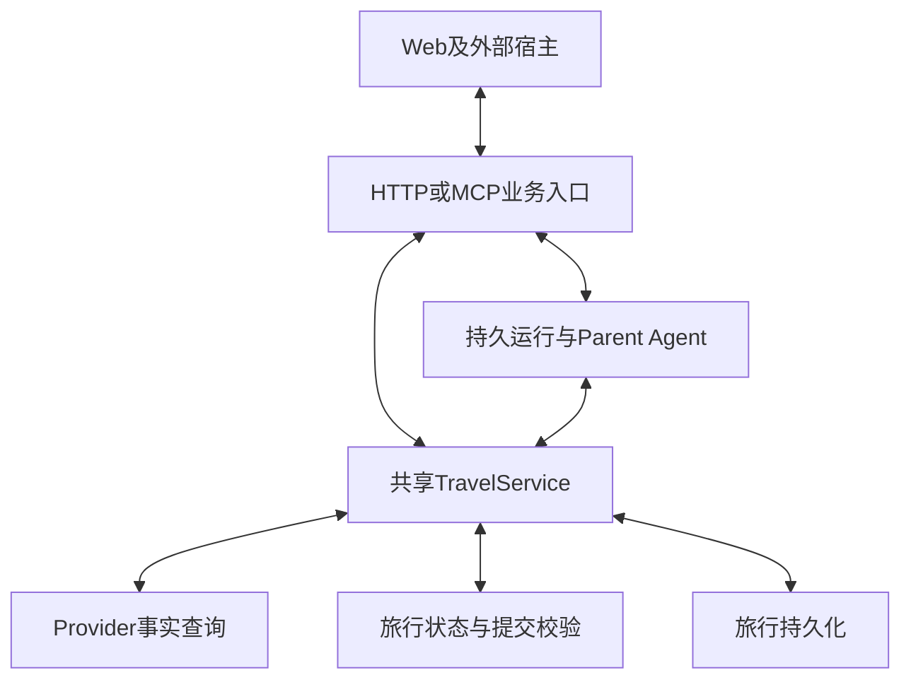

校验包括当前旅行版本、读取对象版本、允许修改的对象、锁定安排和报价新鲜度。界面生成选择不意味着可以绕过服务端提交。相比仅暴露搜索工具，这些基础能够支撑连续规划；是否对旅客可靠，仍需真实完整路径验收。[实际校验实现](../../travel-agent-pi-package/src/runtime/trip-runtime-implementation.ts)

| 对比面 | 我们当前能证实的基础 | 实际差距或仍待证明的结果 |
| --- | --- | --- |
| 首次使用 | 免登录入口，中英切换，示例填入后由用户发送 | 需要继续验证真实信息不足时如何取得首次价值 |
| 问题与接续 | 结构化问题、答案关联、过期问题保护和持久运行 | 回答一次后自动完成原任务的稳定性，不能由控件存在推断 |
| 地图与行程 | 发现、路线、Today、详情及已采用安排 | 多个提案和最新候选是否始终与聊天比较内容一致 |
| 酒店决策 | 房型、面积、早餐、退改等已返回字段及证据详情 | 研究深度、同口径报价比较、价格条款的清晰呈现 |
| 本地与跨城交通 | 飞猪/途牛与高德接驳，逐人限制和时间核验 | 真实班次、路线、晚班与异常恢复的完整用户验证 |
| 海外能力 | Google Maps、Skyscanner、Viator 已进入组合 Provider | 合作授权、真实账号、真实库存与完整海外路径验收 |
| 长期关系 | 保存的单趟进展、账号与成员基础 | 跨旅行偏好、邮箱订单提取、共享编辑、长期关注与通知 |
| 购买 | 跳转准备与用户确认记录 | 没有代理代购和权益网络；当前明确不自动购买 |

当前代码有一处值得继续追踪的风险：`PlanCanvas` 仍从 `pendingProposals[0]` 取得主要候选提案。若一次旅行同时存在旧草案和新比较结果，展示哪个集合依赖此处投影。本轮没有在真实候选流程复现，故仅列为源码风险，不宣称新发现的现行 Bug。[当前投影](../../src/web/travel-app.jsx)

另一方面，当前路线按钮已经按 `selectedAlternativeId` 判断选择，不能直接沿用 9 月报告中“页面只按交通方式选路线”的旧代码判断。这说明本地工作区与旧验收版本必须分开。

### 本轮实际观察了我们的哪些 UI

使用当前源码启动隔离的本地 API 与 Web，数据放在临时目录，没有加载项目模型、地图或供应商凭据，也没有提交规划请求。实际检查了手机宽度 390×844 的入口、示例需求填入和中英切换。下面是本轮保存并目测的画面。

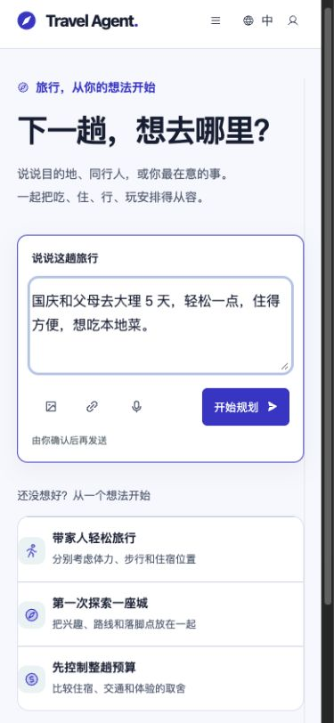

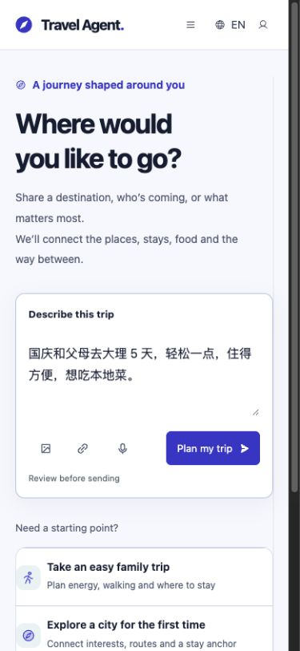

| 实际步骤 | 观察结果 | 健康判断 |
| --- | --- | --- |
| 打开入口 | 可以先输入，不要求登录；主操作明确 | 该入口成立，尚未验证生成结果 |
| 点击家庭旅行示例 | 只填入文本，发送按钮启用，没有立即发请求 | 操作可预期，可继续修改 |
| 切换英文 | 界面切换，原中文需求保留 | 没有覆盖用户输入；更长英文内容需向下滚动 |
| 查看手机可访问结构 | “我的旅行”缩成图标后在可访问树中没有名称；源码未给此按钮独立标签 | 确认的局部可访问性缺口；本轮只记录，未修改 |

桌面 1440×1000 也读取了结构，但取得的图像文字模糊，未把它当作精细视觉验收证据。本轮没有操作候选比较、实际路线、预订跳转、键盘全流程或真机。不能用入口截图评价整个工作台优劣，更不能把无凭据隔离环境的能力边界当成实际部署故障。

9 月 30 日报告属于另一提交的历史用户 QA，可用于说明当时哪些路径尚未通过；它使用真实模型、HTTP 和 PostgreSQL，旅行来源明确模拟。本轮没有重新验收其中所有缺口，也不把历史失败自动判作当前代码仍失败。[历史报告](./2026-09-30-pr5-real-user-qa.md)

## 六、建议吸收什么，先讨论什么

以下是研究建议，不是已确认开发计划。

**优先深化现有黄金路径：** 让旅客始终看到当前要求、已选安排、尚缺事项和下一步；新候选不能被旧提案遮住，局部更换不能丢掉其他选择，失败后可以继续。Odessia 的演示启发在于这些对象如何持续可见，不能只理解成扩大候选数量。

**适合讨论的产品改进：**

1. 旅行摘要中的关键事实能否直接修正，并预览会影响哪些安排。需确认哪些字段直接编辑、哪些取舍仍交给对话。
2. 酒店比较先覆盖少数对本次旅行有意义的维度，给出来源、房型条件与未知项。需确认首要旅行者、比较深度和真实数据供给。
3. 把计划预算、已报价小计、现场估算和已预订金额分别呈现。需确认汇率、税费未知和跨币种口径，避免一个漂亮总数误导决策。
4. 若加入关注任务，先限定一个有真实供应商数据、能够停止且只通知的场景。需确认期限、频率、通知渠道及授权。

**需要独立选择的方向：** Gmail/Calendar 接入、跨旅行偏好学习、共同编辑、支付凭据托管、代理代订、会员权益和售后服务。它们分别引入新的隐私、协作、后台运行或交易责任，不能以“竞品有”作为默认实现理由。

**没有证据支持的改动：** 为追随 Odessia 迁移到 LangGraph；机械增加子 Agent；用模型满意度分数代替业务验收；复制尚未证明有效的综合评分；将宣传图做成我们的能力完成证据。

### 用具体场景检验借鉴是否有效

| 场景 | 用户应看到的完成证据 |
| --- | --- |
| 已选活动后补酒店 | 比较依据包含已有地点；采用后活动、日期与同行人保留 |
| 只换成可退房价 | 明确房型、总价与条款变化；未授权的其他安排保持原状 |
| 修改抵达日期 | 已保存事实真正更新，受影响时间失效并重新核验，旧报价不假装有效 |
| 有一个项目失去库存 | 明确哪些仍可用、哪些不在本次执行中，提供恢复动作 |
| 关注价格但不购买 | 条件和期限可查看、可停止；出现变化只通知且不重复打扰 |
| 预算比较 | 可核对已报价、估算和未知的组成；一个小计不被称作全程总额 |

这些场景可以在现有业务入口上验收。只有涉及新增用户行为的部分经讨论确认后，才进入实现。

## 附录：研究材料、定位与复核边界

### 主要一手材料与独立记录

| 材料 | 本文使用方式 |
| --- | --- |
| [Odessia 当前官网](https://odessia.com/) | 停服事实，本轮浏览器截图 |
| [墨西哥城产品演示](https://x.com/FDavidsonT/status/2064754470911959505) | 原视频 228.136 秒；问题、地图、清单、酒店及航班画面 |
| [新西兰酒店比较演示](https://x.com/FDavidsonT/status/2110417810941993184) | 原视频 78.3 秒；详情、房型、结账及部分不可用项；右半竞争产品不作为独立测试 |
| [十月发布片原帖](https://x.com/FDavidsonT/status/2110417685486141697) | 原视频 85.269 秒；多人及持续关注的宣传表达 |
| [洛杉矶升级演示](https://www.linkedin.com/posts/francisdavidson_watch-me-use-ai-to-book-a-trip-to-la-in-2-activity-7481075060032552960-Jfyc) | 指定酒店与开放比较、现金或积分、选择到结账；不证明支付成功 |
| [十月产品说明](https://www.linkedin.com/pulse/introducing-odessia-francis-davidson-gkw8c) | 长期偏好、共享与关注任务；另有个案反馈 |
| [LangChain 官方技术分享](https://www.linkedin.com/posts/langchain_congratulations-to-odessia-on-their-public-activity-7467665788288679936-DFsW) | LangGraph、LangSmith、模型满意度评估 |
| [LangSmith Engine 视频](https://www.youtube.com/watch?v=hsJ9t2scY5g) | 141 秒；工具、时延、运行轨迹与代码联合诊断；自动字幕有误识别，不逐字引用 |
| [OpenAI for Startups 发布介绍](https://www.linkedin.com/posts/openai-for-startups_consumer-agents-require-very-fast-very-activity-7467998806081482752-nGwo) | 发布阶段模型与 Codex 开发使用说明 |
| [酒店报告样例](https://odessia.com/hotels/hong-kong/hong-kong/burlington-hotel) | 搜索收录的历史酒店维度，评分算法未验证 |
| [历史服务条款](https://odessia.com/terms) | 搜索收录；直接访问已返回 410，仅用于分析披露范围 |
| [SKY VC 第一手测试记录](https://www.sky-vc.com/blog/who-owns-the-booking-moment-we-put-personal-ai-agents-to-the-test) | 一次航班流程的时间、选项及外部跳转，不是总体基准 |
| [8 月创始人采访](https://www.inc.com/georgia-fearn/after-sonders-collapse-its-founder-is-trying-to-engineer-failure-out-of-his-next-startup/91382714) | 当时的日期更新问题和人工购买确认，不能跨版本外推 |

截图文件名中的秒数是原视频时间点，不是实测系统响应时间。视频有剪辑、加速或宣传表达，尤其不能拿分屏比较片计算双方端到端延迟。保留的图片用于内部研究与评论，原作者权益不变；没有重制或生成仿冒界面。

### 我们工作区的证据定位

本轮查看的是含大量未提交改动的本地工作区。HEAD 为 `d676c3138259db170ce8435bbb27f0e896842493`，**HEAD 不能代表所观察的源码版本**。以下内容哈希用于识别本轮读取文件，不作为提交或发布记录。

| 文件 | SHA-256 |
| --- | --- |
| `src/web/travel-app.jsx` | `f989f87adafaa2ac5251d205aba7e7efd9e8c615a2c550bf9299ba343af54202` |
| `src/web/execution-progress.jsx` | `e3d8f7d124ccb755cb4b47efbfd1c917183ffcc4db16569e9557cc310823774f` |
| `src/agent/travel-execution-service.mjs` | `5dbf9f0ec06d2b5974371dae2f07bfb70ab2500352e1ea9a000613a642267aa3` |
| `src/providers/travel-research-provider.mjs` | `ae0bfe55aac22a4520032e455d776469f42b682d3f9f1ee891a1ca25517c8de6` |
| `travel-agent-pi-package/src/runtime/trip-runtime-implementation.ts` | `3682d643f82ee5bf82ee219bd5b80bb16f515f763642245a9ad1b6e4041a843a` |

本轮额外产物是本报告、阅读版及研究图片。没有修改产品实现、项目要求、Skill 或运行时合同；没有提交、推送、部署或真实购买。前一轮海外合同检查通过的结论保留其受控来源边界，本轮没有重复运行来制造新的业务完成声明。
