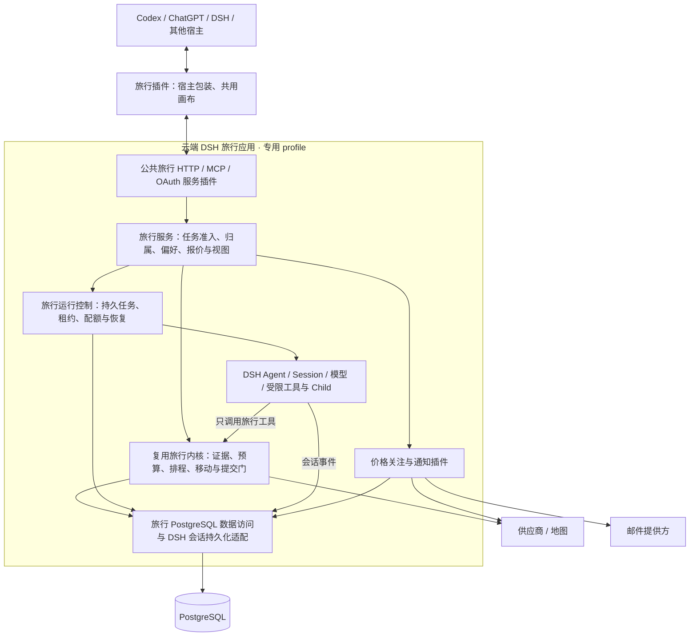

# Travel Agent 架构评估 v0.3：DSH 作为整个后端基座

> 后续状态：用户已授权完善设计、实施迭代并上传仓库。本稿记录架构论证时的依据；文中的“仅方案/未授权/未执行”是当时状态。最新实现和未验收项见[本轮交付记录](./2026-11-11-plugin-app-implementation.md)，当前规范见[17 Plugin App 与 DSH](../current/17-plugin-app-and-dsh.md)。

日期：2026-11-11。状态：**目标架构及跨实例安全接续要求已确认；当前仅细化验证方案，未授权开发或迁移**。对应[产品迭代计划](./2026-11-11-plugin-app-product-iteration-plan.md)及[跨实例验证方案](./2026-11-11-dsh-backend-validation-plan.md)。

## 1. 结论与推荐

**用户已确认以 DSH 作为整个后端的应用与 Agent 目标基座，继续细化验证方案。** 具体采用“云端 DSH 应用＋旅行服务插件＋现有业务内核与 PostgreSQL＋跨宿主插件界面”。对新规划任务，以 DSH Agent 替换 Pi Coding Agent 的会话与执行控制；Pi 不再作为另一个主运行时嵌套在 DSH 中。首版支持其他实例安全接续可恢复任务，业务和 DSH 会话均以共享 PostgreSQL 为目标，不能依赖原实例文件恢复。

这里需要修正上一版的比较前提：**采用 DSH 后端，不需要重写旅行业务。** 行程状态、预算、排程、移动、证据与唯一提交门可以继续复用，只改变它们的装配、执行与生命周期拥有者。把 DSH 迁移与业务整体重写绑定，会低估这条路线。

不过，公开源码只能证明“这套结构有明确实现入口”，不能证明当前 DSH 默认组合已适合多用户旅游服务。目标结构已确认；后续仍需通过同一旅行主路径验证账号隔离、恢复、原图不留存、工具权限与长任务，再评审实际切换。**这不是开发或迁移授权，也不是生产可用结论。**

### 对产品的具体意义

用户在 Codex、ChatGPT、DSH 等宿主安装旅行插件，继续使用宿主对话；画布、行程与账号连接到同一云端服务。云端 DSH 负责应用运行和内部旅行 Agent，用户无需安装或操作后端 DSH。价格关注在云端运行，关闭本地宿主不会终止任务。

DSH 的价值主要是：模型、工具、会话、受控并行和产品服务使用同一套有生命周期的扩展方式，减少以后每次增加能力都去修改中央对话服务。它不能直接带来更好的房型资料、交通接驳或比较界面；酒店与交通的产品深化仍须独立完成，且继续占主要投入。

## 2. “整个后端”具体包含什么

本方案让 DSH 拥有后端进程启动、服务依赖、Agent 创建/恢复、工具注册及统一关闭；旅行 API、鉴权、数据库访问、偏好、价格关注与通知作为我们维护的服务插件运行在这个应用中。

这允许继续使用 Express、MCP SDK、`pg` 和现有业务代码。基座负责装配和运行，不要求替换成熟的 HTTP、数据库库或把每条业务记录改成 DSH Session 事件。只有把这些服务的拥有者和 Agent 控制真正迁过去，才构成本方案；仅把原 Express/Pi 应用包成一个 DSH 启动插件，收益不足。

| 层 | 本方案中的选择 | 不同于上一版的地方 |
| --- | --- | --- |
| 后端应用根 | DSH 启动器加载专用 travel profile，装配受信任的旅行 bundle | DSH 不再只作为客户端宿主 |
| 内部旅行执行 | DSH Agent、Session、模型适配、工具与受限 Child | 新任务不再由 Pi Coding Agent 执行 |
| 业务规则 | 保留 Trip Runtime、排程/Mobility/预算/证据和 Parent 提交门 | 换运行基座，不改已确认的旅行含义 |
| 公共 API 与登录 | 现有旅行 HTTP/MCP/OAuth 处理器改由服务插件拥有 | 不直接把 DSH 管理 API 暴露给消费者 |
| 数据 | 现有 PostgreSQL 继续存旅行、用户与持久任务；DSH 会话日志需适配 | 不把业务库整体搬进默认 JSON/SQLite KV |
| 客户端 | 共用画布＋各宿主薄包装 | 客户端协议不依赖云端使用 Pi 还是 DSH |

DSH 官方架构允许 profile 通过 bundle 与有序 patch 组装；它的 Agent 句柄支持程序化创建、恢复和作用域工具。对应实现入口存在于启动器和 Agent 工厂，不必 fork 框架内核。[架构](https://github.com/deepseek-ai/deepseek-harness/blob/fcc0ad462172522aaf5c93a7b2e01f6b9f0b0159/docs/architecture.zh.md)、[profile 源码](https://github.com/deepseek-ai/deepseek-harness/blob/fcc0ad462172522aaf5c93a7b2e01f6b9f0b0159/packages/boot/app-boot/src/profile.ts)、[Agent 接口](https://github.com/deepseek-ai/deepseek-harness/blob/fcc0ad462172522aaf5c93a7b2e01f6b9f0b0159/packages/core/agent/README.zh.md)

## 3. 重新核验的事实

本轮重新读取 DSH master，调查时仍为 `fcc0ad462172522aaf5c93a7b2e01f6b9f0b0159`。下述 DSH 引用均固定到该 SHA；没有把之前的 Superagent 研究原型当作当前框架能力。

### 3.1 DSH 提供了可用的运行控制入口

`ctx.agents.create()` / `resume()` 返回拥有生命周期的句柄，可在 Agent 发布前通过 `setup` 装配该 Agent 的工具、上下文与监听器。标准 loop 管理消息收件箱、模型步骤、工具执行、取消和事件；工具执行合同包含并发控制、取消、按模型顺序返回结果及已开始工作排空。

这比仅采用一个插件配置文件更有实质价值：我们可以把每次旅行执行的用户、旅行、版本、权限和预算绑定在对应作用域中。现有 Parent/Child 业务合同继续使用，Child 仍仅分析有来源资料并返回提议，不获得购买或提交权限。[Agent loop](https://github.com/deepseek-ai/deepseek-harness/blob/fcc0ad462172522aaf5c93a7b2e01f6b9f0b0159/packages/core/agent-loop/README.zh.md)、[工具执行合同](https://github.com/deepseek-ai/deepseek-harness/blob/fcc0ad462172522aaf5c93a7b2e01f6b9f0b0159/packages/core/tools/src/executor.ts)

### 3.2 持久化可替换，但 PostgreSQL 不是默认赠送能力

DSH 把会话日志持久化定义为独立服务，后端需实现创建、打开、读取、追加、flush 与关闭等合同，并保持连续日志与单写者语义。默认提供方为 JSONL，其他后端可实现相同接口。只有完成 flush 才构成通用合同的崩溃持久性保证。

这使旅行服务接入自己的数据库有明确入口，但不能说“加一段 PostgreSQL 配置就完成”。另外，普通 `storageDomain` 是领域 KV 接口，当前交付 JSON/SQLite 提供方；它不提供我们现有跨表事务、任务领取或业务版本提交的等价语义。[会话持久化](https://github.com/deepseek-ai/deepseek-harness/blob/fcc0ad462172522aaf5c93a7b2e01f6b9f0b0159/packages/session/session-persistence/README.zh.md)、[领域存储](https://github.com/deepseek-ai/deepseek-harness/blob/fcc0ad462172522aaf5c93a7b2e01f6b9f0b0159/docs/subsystems/storage.zh.md)

### 3.3 原生 Schedule 能定时投递，不等于业务任务完成

原生 Schedule 有时区/重复规则、暂停恢复、持久记录、目标会话激活和最近投递历史；它在宿主运行时工作。官方实现说明其交付至少一次，Session flush 与任务回执是独立提交，崩溃后可能重复。回执证明进入收件箱，不证明已经执行、查询成功或发送邮件。

因此它适合一般“定时让 Agent 做事”。机酒价格关注却需要确定的对象、同条件匹配、截止、配额、通知去重和真实投递结果；不能把每个关注变成一句永久重复的自然语言指令。[Schedule 合同](https://github.com/deepseek-ai/deepseek-harness/blob/fcc0ad462172522aaf5c93a7b2e01f6b9f0b0159/packages/schedule/schedule/README.zh.md)

### 3.4 原生权限不等于多用户产品鉴权

DSH 的 Remote Access 有非 owner 的方法级访问控制；owner 不受这层检查，Remote 调用之外的 `allows()` 也不是旅行用户归属校验。源码还明确：原生 `session/attachment` 权限覆盖整个 Host 的附件存储，不按每个 Session 的引用隔离。

这不是宣称 DSH 存在未披露漏洞，而是其已公开的权限范围。我们的云端公共入口只能暴露旅行 API/MCP，并继续检查账号、旅行、运行和报价归属；不能把所有消费者映射为 DSH owner，也不能直接开放原生附件读接口。[Remote Access](https://github.com/deepseek-ai/deepseek-harness/blob/fcc0ad462172522aaf5c93a7b2e01f6b9f0b0159/packages/api/remote-access/README.zh.md)

### 3.5 默认组合不适合直接上线为旅行后端

`sdk` 含 coding persona、文件工具、插件管理等；`sdk-minimal` 虽小，仍默认有持久 Shell 与 `danger-full-access`。不能凭“minimal”名称就认定它更符合旅行服务需求。我们需要专用组合，显式选择模型、Session、工具、压缩及服务插件，排除任意 Shell、通用文件写入、运行时安装插件、桌面控制和无关工具。[SDK 组合](https://github.com/deepseek-ai/deepseek-harness/blob/fcc0ad462172522aaf5c93a7b2e01f6b9f0b0159/packages/bundle/sdk-app/README.zh.md)、[minimal 组合](https://github.com/deepseek-ai/deepseek-harness/blob/fcc0ad462172522aaf5c93a7b2e01f6b9f0b0159/packages/bundle/sdk-minimal/README.zh.md)

### 3.6 用户图片有真实语义冲突，必须先解决

当前项目要求用户原图只存在于本次请求，不落盘或进入持久对话。DSH 默认附件流程则在消息接纳前保存图片，供之后会话复用，默认不自动删除。不能直接沿用后再声称符合现有边界。

DSH LLM 接口存在仅供请求使用的 user 输入，但这不证明标准 Agent loop 已具备“请求内图片且不落盘”的入口；源码中 loop 的模型请求来自持久 Session 投影，不能将它误写成一个已验证的配置开关。需验证自定义暂存附件/模型请求适配能保持本项目语义，且不会把图片字节、私密元数据或附件访问能力泄漏到日志及其他用户。[附件合同](https://github.com/deepseek-ai/deepseek-harness/blob/fcc0ad462172522aaf5c93a7b2e01f6b9f0b0159/packages/attachment/attachment/README.zh.md)、[LLM 输入](https://github.com/deepseek-ai/deepseek-harness/blob/fcc0ad462172522aaf5c93a7b2e01f6b9f0b0159/packages/llm/llm/README.zh.md)、[loop 请求源码](https://github.com/deepseek-ai/deepseek-harness/blob/fcc0ad462172522aaf5c93a7b2e01f6b9f0b0159/packages/core/agent-loop/src/agent.ts)

### 3.7 多模型路径存在，替换 Pi Coding Agent不等于删除所有 Pi 库

DSH 可直连 DeepSeek，也有 `dsh-llm-pi-ai` 适配器，用于多提供方及 OpenAI 兼容网关。后者可能继续使用 Pi 的模型协议库；它与保留 Pi Coding Agent 的会话、工具循环和扩展系统不是一回事。当前 DeepSeek/Kimi 等路由仍需对实际模型、协议和取消/重试进行验证，不能仅凭目录存在就宣布兼容。[多模型适配器](https://github.com/deepseek-ai/deepseek-harness/blob/fcc0ad462172522aaf5c93a7b2e01f6b9f0b0159/packages/llm/llm-pi-ai/README.zh.md)

## 4. 推荐的整体结构

下图是拟议责任结构，不代表已经实现，也不要求每个框单独部署。

DSH 的插件上下文负责装配；旅行接口负责消费端协议。我们可以把现有 Express HTTP 和 MCP 服务注册为 DSH 插件拥有的服务，保留成熟鉴权和处理器；无需为了“原生”重写 HTTP。如果使用 DSH 自带 `webServer`，其原始具名路由也仍要自行鉴权，不能假设 GUI Host 的权限会自动覆盖业务处理器。[HTTP 载体合同](https://github.com/deepseek-ai/deepseek-harness/blob/fcc0ad462172522aaf5c93a7b2e01f6b9f0b0159/docs/subsystems/web-server.zh.md)

云端 DSH 与用户电脑上的 DSH 是两个独立实例。后者只安装旅行客户端插件与连接器，不能因此持有云端供应商凭据、数据库访问或维护权限。Codex/ChatGPT 同样不需要加载 DSH 运行时。

### 先组织为一个旅行 bundle，内部明确四组职责

| 组 | 插件责任 | 主要复用 |
| --- | --- | --- |
| 旅行平台服务 | 公共 HTTP/MCP、OAuth、账号、数据库与视图入口 | `src/http/`、`src/mcp/`、`src/persistence/` |
| 旅行业务 | 单一 Trip、证据、四域联动、排程/Mobility/预算、Parent 提交门、偏好 | `TravelService`、严格 TypeScript 的 core/contracts/runtime、Provider |
| 旅行 Agent | DSH 模型与工具装配、上下文、问题、受限并行、事件到业务状态的转换 | 现有 Prompt、Skill、上下文包与任务合同；替换 Pi 专属接线 |
| 持续服务 | 机酒关注、同条件检查、任务领取、站内消息与邮件投递 | 现有账号/数据库/租约原则；关注与通知仍是新增产品能力 |

这是职责分组，不要求一开始发布四个独立 npm 包，更不按吃住行玩拆四个工作流。可信插件依赖固定版本、独立测试和明确关闭；生产环境不让旅行 Agent 自行安装任意插件。新增能力通过所在拥有者接入，而不是继续扩充一个中央聊天函数。

## 5. 业务、执行与界面状态，以及两级执行控制

| 对象 | 唯一真相源 | 完成的含义 |
| --- | --- | --- |
| 旅行及选择 | PostgreSQL 中的 Trip、采用方案、草案、证据与版本 | 提交门成功保存并可重新查询 |
| 旅行任务 | 持久 run 及其租约/权限/输入/业务结果 | 产生可用提案、需要用户回答或明确失败；不是模型停止输出 |
| 模型会话 | DSH Session 与其持久化后端 | 一段模型上下文及步骤已持久化；不是旅行已经采用 |
| 关注与通知 | 关注记录、检查结果及各渠道投递记录 | 真实检查并按规则保存/通知；不是定时指令入队 |
| 视图状态 | 画布的选中项、展开项与显示模式 | UI 可继续操作；不覆盖业务状态 |

现有运行队列与 DSH Agent loop 不是必须二选一：队列决定哪个有归属和配额的旅行任务获得执行权；DSH 决定该任务内的模型步骤与工具循环。**同一任务只能有一个有效租约和一个执行 Agent**。队列不重建第二套模型循环，DSH 不绕过旅行准入自行接管任意用户任务。

当前自动推进、等待与继续执行的业务决策仍只有一个拥有者；不能同时开启 DSH 通用 Goal 自动轮次和另一套旅行推进器，让它们各自续跑。用户问题沿用持久问题标识、依赖版本和回答校验，转交宿主显示；云端不依赖 DSH 本地弹窗或长期占住一个等待人点击的 Agent。压缩只保留上下文，不取代权威 Trip：每轮重新载入相关事实、有效来源、待决问题与预算，旧价格和推断不得因摘要变成确认事实。

账号/旅行/run/DSH session 的关联由服务生成并保存，客户端不得传一个 sessionId 就恢复任意历史。发起者信息跨队列、进程和重启显式携带；DSH 文档明确其进程内发起方归因不能自动穿越这些边界。旧租约的工具提交在业务门被拒绝，取消或部署关闭时排空/中止对应 Agent，不能只从内存列表删除。[作用域与发起方](https://github.com/deepseek-ai/deepseek-harness/blob/fcc0ad462172522aaf5c93a7b2e01f6b9f0b0159/packages/core/agent/README.zh.md)

DSH 恢复能配平中断的模型工具日志，不代表外部业务副作用已回滚。工具结果丢失但可能已提交时，先按操作标识回查旅行，再决定继续；不自动重放。模型达到 token/步骤限制也只能报告未完成或待继续，不能映射为“旅行规划成功”。

## 6. 哪些保留，哪些替换，哪些仍需新增

### 保留与适配

当前 `travel-agent-pi-package/src/core/`、`src/contracts/`、`src/runtime/` 未发现直接导入 Pi 的 Agent/TUI 包。这支持保留算法与合同、迁移组合边界；但包名中的 Pi 不是解耦证据，工厂与调用方仍需调整。

| 当前拥有者 | 目标处理 | 实际改动含义 |
| --- | --- | --- |
| `trip-runtime-implementation.ts`、连续规划、预算、排程与 Mobility | 保留 | 禁止以 DSH 日志重写替代业务规则；维持版本、读取/写入、锁定、新鲜度校验 |
| `src/api/create-travel-service.mjs` | 改组合与依赖注入 | 当前工厂会创建 Pi 相关 fan-out；改为使用 DSH 旅行执行服务，不只改文件夹名 |
| `src/agent/travel-conversation-agent.mjs` | 保留业务语义，迁移控制接线 | 替换 Pi 事件、prompt、压缩/续接调用；问题、提案、核验和失败含义保持 |
| `travel-agent-session.ts` 与 Pi host 兼容扩展 | 从新任务主路径退出 | 当前使用 `SessionManager`、扩展绑定、Pi checkpoint 等，不是可原样载入 DSH 的插件 |
| `travel-analysis-fanout.mjs` | 以 DSH 受限 Child 执行替换 | 保留有界并行、证据只读、覆盖记录、过期结果拒绝和 Parent 单次 Join |
| `travel-execution-service.mjs`、`execution-repository.mjs` | 保留业务准入与租约，适配执行控制 | 当前已有 PostgreSQL 排队、用户配额、fence 与有限恢复；不夸大为任意写后自动恢复 |
| HTTP/MCP/OAuth、Trip repositories、Provider | 包为 DSH 服务，按需小改 | 不复制客户接口，不让模型直接持有凭据，也不把候选 fixture 当接线证据 |
| 共用画布和宿主包装 | 继续产品迭代 | 后端迁移不改变已确认的“宿主对话＋动态画布”交互 |

### 新增但由当前结果直接需要的能力

1. **DSH 旅行组合与执行插件**：严格白名单；注册旅行工具、模型路由、业务事件与上下文。不复用默认 coding persona 或全权限 Shell。
2. **DSH 会话持久化方案**：已确认保留跨实例安全接管，采用现有 PostgreSQL/`pg` 适配原生 `SessionPersistence` 合同，承接单写者、flush、格式和恢复；不是把 Pi checkpoint JSON 改个字段名。单实例＋持久卷 JSONL 虽能服务多个用户和宿主，但不满足本轮确认的故障恢复目标，不作为迁移完成方案。具体执行权、操作回查和故障场景见配套验证方案。
3. **请求内图片适配**：保持原图不落盘及不进入持久历史；数据缺失后明确要求重附，不自动制造图片观察。可行路径尚待验证。
4. **价格关注与投递**：仍按产品计划新增。将任务、检查、阈值事件与待发邮件保存于 PostgreSQL；事务与去重由业务负责，不依赖 LLM 自觉。

上述适配是迁移的主要成本。DSH 的模块化减少后续能力接线的分散程度，但不会消除这些工作，不能用“全部已有插件”掩盖。

模型预算要覆盖 Parent、Child、压缩与重试的实际请求，而非只统计用户轮次。原生重试或辅助模型不能绕过现有全局/逐用户配额；默认选项的具体效果必须在适配验证中观察。受限 Child 的工具可见性与权限也要在实际执行层限制，不能仅提供一段“不要提交”的提示词。

## 7. 价格关注如何在 DSH 后端中运行

建议由旅行关注插件领取 PostgreSQL 中到期任务，调用确定的 Provider、核对同条件价格，再产生通知事件；它不必为每次查价启动一个 LLM。所有用户的关注列表、暂停/截止与最新结果仍只有一份业务真相源。

原生 Schedule 暂不作为每条价格关注的总账，避免在其宿主级任务和我们的关注表中各维护一次状态。后续若增加用户明确要求的自然语言定时研究，可以单独采用 Schedule，并将它投递到有权限/预算的业务任务入口；仍需按发生标识防止重复执行。

关注检查与通知分别记录结果：供应商失败保留上次有效报价，不生成降价；站内通知和待发邮件在同一事务建立；邮件重试不重复制造事件。用户关闭宿主不影响云端进程，云端暂停或部署中断则由持久记录恢复。这些能力由 DSH 承载，但产品正确性来自旅行关注规则与数据库合同。

## 8. 与保留 Pi 方案的公平比较

| 判断项 | Pi 暂留执行器、现有后端升级 | DSH 作为整个后端基座 |
| --- | --- | --- |
| 短期产品推进 | 迁移少，可直接补比较和变化预览 | 要先完成专用组合、持久化和语义适配；不能把 UI 一直排在后面 |
| 后续模型/工具/执行扩展 | 当前已有单独适配，但仍跨多处编排 | 生命周期、作用域、执行及服务注册更统一，前提是实际使用这些边界 |
| 业务资产 | 都能保留 | 都能保留，整体基座迁移不等于重写业务 |
| 长期关注 | 都要实现业务匹配、调度和通知 | 原生 Schedule 有参考/复用范围，但不直接替代关注系统 |
| 跨宿主分发 | 都需 MCP、UI 和宿主包装 | DSH 云端不会自动把其 Client 插件变成 Codex 插件 |
| 数据与用户隔离 | 现有账号/数据库路径继续验证 | 除复用现有边界，还要证明 DSH Session、工具、事件和附件不会跨用户泄漏 |
| 升级成本 | 当前只放行 Pi 0.85.1，升级有适配成本 | DSH 仍为 developer preview，接口/格式可能变动；固定依赖与受控升级不能省略 |
| 何时更值得选 | 优先低迁移成本，扩展需求集中 | 已确定长期建设多宿主 App，持续扩充后台 Agent 与服务，愿意承担一次有边界的迁移 |

结合已确认范围——跨宿主 App、持续规划、受限并行、长期偏好、后台关注和通知——**现已确认以 DSH 主导后端为目标，先证明适配成本和关键行为，再评审切换**。理由是这些能力持续跨越执行与服务生命周期，DSH 的统一组合有实际使用对象；并非因为“插件多”本身更先进。

若验证显示必须长期 fork Agent loop、削弱图片不留存或隔离边界、无法稳定恢复，或者基础迁移持续吞噬产品深化投入，则暂停受影响切换并回到技术评审，说明阻断和替代方案；不能自主改回 Pi，也不能仅因已投入 DSH 就继续扩大重构。

## 9. 按可见结果迁移，避免产品停摆

### 第一步：形成专用组合并验证同一主路径

在隔离环境使用固定 SHA/许可/依赖审计后的 DSH；只装旅行需要的能力。以“完整规划→酒店比较→局部更换→采用→关闭恢复”为同一验收旅行，调用现有 TravelService 和提交门。先证明能继续产品迭代，再扩展后台职责，不先建设通用插件管理平台。

验证阶段可以保留旧 Pi 部署作对照；同一个 run 只能绑定一个执行器，不允许 DSH 失败后偷偷交给 Pi 重跑。静态或 fixture 检查只证明组合与合同；真实模型、真实供应商、持久化与宿主结果分别记录。

### 第二步：迁移运行控制与持久会话

把新 run 路由到 DSH，完成事件映射、问题回答、并行 Join、配额、取消与恢复；按已确认的共享 PostgreSQL 会话存储与跨实例接管，通过原生 persistence 合同和业务回查验证。旧 Pi checkpoint 与 DSH Session 不可直接互读。

旧已采用旅行继续读取原业务库；切换时没有运行中的任务才能为新执行器建立上下文。从权威 Trip、有效证据、未决问题、锁定项与必要历史重新建立 DSH 会话；这属于重新构造上下文，不宣称完整恢复旧 Pi 的隐藏过程。含未知写入的旧任务先查询真实结果，再收敛，不能自动换执行器接管。

### 第三步：业务服务由 DSH 统一拥有

公共 HTTP/MCP/OAuth、数据库服务及关注/通知插件由同一 travel bundle 装配与关闭；去除 Pi Coding Agent 主路径和无用兼容接线。保持对外协议与旅行数据语义稳定。旧客户端仍可访问同一旅行服务。

### 第四步：完整交付长期能力与宿主体验

接通偏好实际使用、机酒后台检查、站内和验证邮箱提醒；按产品计划逐宿主验收 UI 与真实路径。产品设计、真实房型/票规数据调查和共用画布深化可在迁移验证期间继续，不能把本轮缩成后端工程。

### 更新与回退

生产更新用受控部署：停止准入/领取新任务，等待或明确中断已有任务，持久化并关闭，再升级固定 bundle。插件化不意味着正在进行旅行写入时热替换任意模块。

业务表优先加法迁移；备份并保留原记录。DSH 日志格式与插件配置单独版本管理。已写入新格式的 Session 不假设旧 DSH 或 Pi 能读取。回退优先保住已采用 Trip、停止新任务并重新建立兼容上下文；只有经过验证的数据与客户端版本组合才允许恢复写入。

## 10. 切换前必须拿到的完成证据

| 真实场景 | 需要证明的结果 |
| --- | --- |
| 两个账号同时规划，并尝试用另一账号的 Trip/run/session 标识访问 | 工具、历史、问题、事件、图片及通知不串用户；服务端拒绝越权，不能只靠 UI 隐藏 |
| 保留航班与预约，只更换酒店 | 新执行器仍只修改相关邻域；预算、接驳与锁定项符合原业务合同 |
| 在模型执行、工具执行、业务提交前后分别中断 | 有持久记录可解释；未知副作用先回查；旧租约不能继续提交 |
| 数据库暂时不可用、flush 失败或新旧 worker 竞争同一会话 | 不假报已保存；只有一个有效写者；恢复不丢已采用方案 |
| 用户上传旅行图片，然后完成、取消、断线或进程退出 | 原图及敏感信息不进入持久状态/日志/磁盘；后续历史不会偷偷复用原图 |
| Agent 尝试调用 Shell、安装插件或 Child 尝试提交 | 能力未暴露或强制拒绝；不能靠提示词约束 |
| 关闭全部客户端后到期检查；重复领取或邮件重试 | 同条件价格匹配正确，通知去重且邮件实际到达；暂停/到期不继续执行 |
| 相同输入和来源对照 Pi 与 DSH | 记录成功结果、人工接续、延迟、模型/工具用量及维护差异；不把 NPS 或框架事件完整度替代旅行业务正确性 |

这些是验证任务的设计，**本轮均未执行**。通过前不报告 DSH 已支持多租户生产、价格关注或跨宿主真实交付，也不凭代码阅读给出未经验证的工期和容量承诺。

## 11. 已确认结论与当前授权范围

已确认以本稿的 DSH 全后端方案继续细化验证：**专用 travel profile；DSH 接管内部 Agent；现有业务内核与 PostgreSQL 保留；公共旅行 API 和各宿主 UI 协议稳定；默认 coding 能力不进入服务。首版支持其他实例安全接续可恢复任务。**

当前授权仅为方案与验收设计，具体见[跨实例验证方案](./2026-11-11-dsh-backend-validation-plan.md)。尚未授权开发验证夹具、安装依赖、运行 DSH、创建后台任务或迁移数据。账号隔离、请求内图片和 DSH 会话持久化仍需实际验证，不能用已确认的架构选择代替技术完成证据。

## 附录 A. 调查范围与项目代码位置

- DSH：固定 SHA 的 profile 启动、Agent/loop/tools、Session persistence、Storage、Schedule、Remote Access、Attachment、SDK、模型适配与 HTTP 文档；并查看 profile、Agent loop 请求组装、工具执行、会话持久化和调度等源码。本轮只读取公开源码，未安装运行。
- 本项目：`agent.md`、`.pi/SYSTEM.md`；`src/api/create-travel-service.mjs`、`src/http/app.mjs`、`src/agent/travel-conversation-agent.mjs`、`travel-execution-service.mjs`、`src/persistence/execution-repository.mjs`、`travel-agent-pi-package/src/host/travel-agent-session.ts`，并检查 core/contracts/runtime 对 Pi 的直接依赖。工作区已有未提交更改，本轮未重置或覆盖产品代码。
- 项目当前的 PostgreSQL 恢复条件有明确限制，例如图片任务、已写业务任务等不能据现有代码声称任意自动恢复。迁移应保留这些诚实状态，并按实际验收扩大能力。
- DSH 的 MIT 许可与 developer preview 状态已核验；正式引入仍需项目规定的固定版本、完整依赖/写面审计和隔离验证。[项目声明与许可](https://github.com/deepseek-ai/deepseek-harness/tree/fcc0ad462172522aaf5c93a7b2e01f6b9f0b0159)
- `dsh-superagent-prototype` 是另外的仓库开发任务原型，本稿不把其仓库 worker、团队接单模型或 Shell 权限作为旅游服务方案。

## 附录 B. 跨宿主交付与首批结论（保留核验结果）

### 共通合同

共同维护旅行 API/MCP、UI bundle、权限语义与版本；分别提供宿主 manifest、Skill 指引和必要桥接。不是一个二进制或一份 manifest 无条件安装所有宿主。MCP Apps 提供跨兼容宿主的 UI 标准，但宿主仍可限制显示模式、网络、权限和工具调用。[MCP Apps 官方说明](https://modelcontextprotocol.io/extensions/apps/overview)

安装后按能力探测确定是否能显示交互 UI、请求展开、发送消息、调用业务工具和安全打开外链。只有工具能力的宿主保留文字操作与明确入口，不能声称达到了本轮完整 UI 验收。首批主宿主不能靠隐藏降级过关。

| 宿主/具体形态 | 当前公开证据 | 建议交付路径 | 首批判断 |
| --- | --- | --- | --- |
| Codex 桌面支持插件的环境 | 官方插件可包含 Skill、MCP 和可选 UI；扩展能力需按表面检测 | 复用 OpenAI 包装；共用 MCP Apps，必要时用官方 sidebar extension | **必须首批**；当前工程中的 metadata 仍需在实际宿主验证 |
| ChatGPT 支持插件的环境 | 与 Codex 共用插件目录；官方推荐 MCP Apps，支持 inline/fullscreen 等呈现 | 共用工具和标准画布；只把 OpenAI 专属能力作为可检测增强 | **必须首批**；账户、组织、分发和审核能力独立核验 |
| DSH Web/Desktop | Host/Client bundle、MCP 客户端、UI slots 均有源码依据 | MCP 接共享服务，原生 Client 插件挂载共用画布，不 fork DSH 根界面 | **必须首批**；固定版本并真实验证卸载清理、鉴权与 UI |
| Claude.ai / Claude Desktop 交互连接器 | 官方支持 inline、side panel/fullscreen；严格 CSP、沙箱、JSON-RPC；界面不支持购买 | **优先标准 MCP Apps，替代“自动生成并绑定 Artifact”作为主路线**；限定域名及外链 | **技术可行，建议一并纳入首批适配**；需满足账号、连接器验证/审查和地图 CSP 实测 |
| Claude Code | 插件可打包 Skill、MCP 等；终端形态与 Claude.ai 不同 | 保持工具可用；图形画布另按实际图形表面验证 | 不能把 Claude Code 工具通过等同于 Claude 完整 App 通过 |
| WorkBuddy | 官方专家/插件支持 MCP 依赖；Buddy 应用文档明确 MCP Apps 或 iframe 集成，并有创建与配置审核 | 共用 MCP＋宿主包装；优先标准 MCP Apps，必要时评估官方 Buddy 应用容器 | **有实现路径，纳入首批适配范围**；公开发布取决于开放平台资格/审核及真实消费端 UI 验证 |

OpenAI 依据：[插件目录与表面](https://learn.chatgpt.com/docs/plugins)、[标准 UI 与可选增强](https://developers.openai.com/plugins/build/chatgpt-ui)。Claude 依据：[交互连接器](https://support.claude.com/en/articles/13454812-use-interactive-connectors-in-claude)、[远程与桌面连接区别](https://support.claude.com/en/articles/11725091-when-to-use-desktop-and-web-connectors)、[Claude Code 插件](https://code.claude.com/docs/en/plugins)。

WorkBuddy 依据：[专家与 MCP 依赖](https://open.workbuddy.cn/docs/expert)、[Buddy 应用](https://open.workbuddy.cn/docs/buddy-app)。后者本次以官方页面 HTML 读取，检索服务多次超时；已读到集成、可信 Origin、OAuth 和发布审核说明。腾讯云的 [MCP Apps 文档](https://cloud.tencent.com/document/product/1831/137044) 在正文写明 CodeBuddy Web/IDE 的适用范围，**不能拿来证明 WorkBuddy 消费端同版通过**。

Claude 所谓“安全限制”与本轮能力不构成根本冲突：本轮不做购买；主要需要处理地图/图片域名、受控工具调用、原页外链与账号权限。浏览器 Cookie、外部网页嵌入或任意网络访问不应成为旅行主路径前提。完整可用与公开上架是两项独立结果，不能把平台审核排除在交付说明之外。
