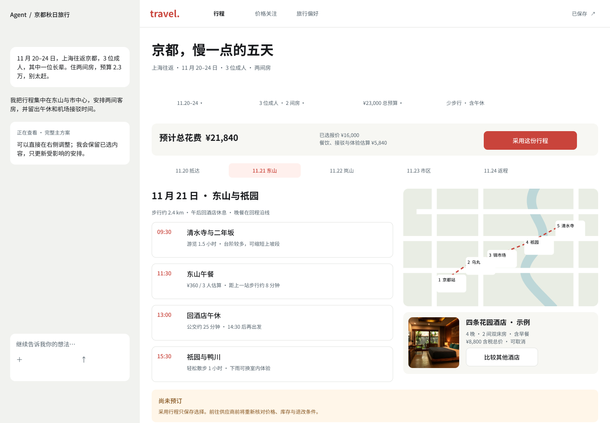

# Travel Agent：Plugin App 产品迭代计划

日期：2026-11-11。状态：**方案已确认，用户后续已授权完善设计与开发。** 本文保留产品范围与验收要求；实际实现、Figma 工具限制和原生宿主缺口见[本轮交付记录](./2026-11-11-plugin-app-implementation.md)。

本文面向产品、设计和开发共同评审。Travel Agent 为国内游客与入境游客提供吃、住、行、玩的连续规划；目的地只用于验收，不限制产品范围。当前问题不是缺少四个入口，而是用户仍需要自行拼接候选，难以比较完整条件、理解调整影响，并把结果持续用下去。

本轮目标：在常用宿主 Agent 安装插件后，通过一次连续对话获得完整主方案，在同一画布中完成比较、调整和保存；离开后仍能关注指定机酒价格，再到任一已连接宿主继续同一旅行。产品能力和 UI/UX 是交付中心，架构改动只服务这些结果。

设计入口：[Figma 可编辑设计与交互稿](https://www.figma.com/design/82SFdSrzhxPby3T44L8ZGx)。技术取舍见[架构评估](./2026-11-11-plugin-app-architecture-assessment.md)。竞品依据见[Odessia 深度研究](./2026-11-11-odessia-deep-product-ux-tech-research.md)；视频演示、宣传承诺与实际使用记录已在该报告分开。

架构评估已更新到 v0.3：用户确认以 DSH 统一承载整个后端为目标，保留业务内核和 PostgreSQL，以 DSH 替换新任务的 Pi 执行，并支持其他实例安全接续可恢复任务。后续用户已授权完善设计与迭代开发，实际验证状态见本轮实现记录。本计划的产品范围、交互及交付终点保持不变；M0 需先证明专用组合、用户隔离、请求内图片与共享持久会话，详见[跨实例验证方案](./2026-11-11-dsh-backend-validation-plan.md)，不能仅凭模块加载成功就进入全量迁移。

## 1. 已确认的产品决定

| 决定 | 本轮含义 |
| --- | --- |
| Plugin = App 为主要产品形态 | 插件包含旅行工具、交互画布、任务入口及安装连接引导；不把下载独立旅行 App 当作首个价值前提 |
| 首批宿主 | Codex、ChatGPT、DSH 必须分别真实验收。Claude 先确认安全与 UI 路径；WorkBuddy 一并研究，可实现则纳入首批适配，平台发布另行验收 |
| 共享云端服务 | 旅行、偏好、关注任务和通知跨宿主共享；关闭本地宿主后仍可检查价格。宿主安装与旅行账号连接是两件事 |
| 宿主对话，插件执行 | 用户继续使用宿主的输入、提问和解释；旅行插件提供业务工具、受控执行及画布。旅行服务决定变更是否能提交 |
| 持续对话＋动态画布 | 桌面对话保持在侧边；画布按任务显示理解、行程、地图、比较或详情。宿主决定实际容器，不在插件内复制第二套聊天 |
| 酒店、交通先做深，四域完整联动 | 酒店与交通具备完整决策条件；餐饮、体验具备选择及排程必需的信息。不能交付四份彼此不相干的答案 |
| 偏好和长期关注全部纳入终点 | 可以依赖顺序交付，但不以先完成主方案为由删去长期能力 |
| 偏好来源 | 仅本产品内表达与选择；开启记忆后保存明确表达，行为推断先确认；旅行例外不覆盖长期偏好；可查看、更正、删除 |
| 价格关注 | 用户指定未订航班、酒店；同条件比较；只提醒；可修改、暂停、恢复、到期或结束 |
| 提醒渠道 | 站内消息＋经验证的邮件地址；本轮不引入浏览器或系统推送 |

本稿继承现有安全边界：不自动购买、支付、退改或进行社交写操作。不把证件、支付信息、手机号、Cookie、Token 或浏览器 profile 放进模型上下文、旅行状态或日志。邮件地址由账号/通知服务保存，模型只见是否可接收邮件。

## 2. 一条可验收的黄金路径

**设计示例**：上海往返京都五天，三位成人含一位长辈，两间房，全程预算 23,000 元。Figma 中酒店名称、图片匹配、价格、评分、时间与来源均为演示数据，地图为示意；不能作为真实旅行建议或供应商接线证据。

1. **安装与进入**：用户安装对应宿主插件，发出旅行要求。可匿名开始时沿用现有 Guest 能力；跨宿主保存、偏好或后台关注时连接旅行账号。连接同一账号后选择已有旅行，不能每个宿主自动新建一份。
2. **理解与补查**：先显示可编辑的日期、人数/年龄类别、出发地、预算范围、房间与关键约束。只追问会改变结果的缺项；有合理默认值时注明并继续。用户只问酒店时只处理酒店，不强制补完整旅行。
3. **完整主方案**：服务自动补查吃住行玩，形成一份推荐主方案，包含按天活动、餐饮、住宿、城市移动与抵离接驳。让用户先评估整趟旅行，再按需要打开候选。
4. **针对性决策**：点击已选酒店或航班进入比较；比较保持同一旅行上下文。用户看清为什么推荐、成本与时间差、缺失条件后选择房型或票价方案。
5. **看影响，再采用**：换酒店先显示预算与每日接驳变化；保留航班、预约与锁定项。确认后保存新方案，提供撤销。选择行程和向供应商预订有明确区别。
6. **继续使用**：关闭再打开仍能看到采用方案、当前草案、待确认事项和最近进度。资料源失败只补查受影响部分，既有结果不丢失。
7. **形成长期价值**：用户开启记忆，明确表达成为可管理偏好；下一次旅行确实使用。对未订机酒创建关注；关闭宿主后达到同条件目标价格，收到站内及邮件提醒；重新核价后由用户跳转供应商自行购买。

成功证据是上述行为实际发生，不能以页面存在、工具可发现或合成数据测试成功代替。

## 3. 产品能力如何做细

### A. 从候选列表升级为可采用的主方案

画布首先显示整趟旅行，而不是四个领域的选项篮子。日期、同行人、预算和关键约束可直接编辑；编辑先形成待检查草案，有跨域影响时展示差异再采用，不能仅往聊天框填一句提示词。

每日安排必须回答：从哪里出发、什么时候做什么、停留多久、如何到下一站、在哪里吃、如何返回住宿。跨城市、机场/车站接驳、午休、营业时间、预约及同行人的行动约束一起检查。未知项明确列为待补充，不能用通用文字补出虚假的可执行性。

预算同时显示：选中且有效的报价、确定性估算、尚未计入部分。总额使用统一币种并说明汇率时间；人均、每晚、每房与整个订单不能混用。缺失不等于零，报价过期不等于当前低价。先给可理解的总额与未覆盖提醒，详细账目再展开。

### B. 酒店：从“推荐地点”升级为“选定入住条件”

比较视图默认展示少量适合当前行程的候选，允许更多结果及筛选；不是固定只查三家。比较卡包括：位置与公共交通、对每日路线的影响、入住资格、评分来源与样本、关键设施、房型概况和**整个住宿订单含税总价**。

酒店详情保持候选返回位置和筛选，展示图片、位置、设施、原始资料。房型与价格方案作为第二层：床型、面积/窗、入住人数、房数、早餐、取消截止及当地时区、预付/到店应付、税费、总价与库存核对时间。没有拿到对应房型/价格方案时，不能把搜索摘要当成已可选库存。

更换住宿必须检查整个路线：机场接驳、每日起终点、午休与时间/费用差。酒店坐标变化触发路线重新计算，不只替换卡片名称。外宾入住资格和无障碍设施属于需要证据的条件，未知就明确待确认。

### C. 交通：从“航班卡”升级为“从出发点到目的地”

并列比较航班/铁路等城际方案，以及机场/车站到酒店的接驳。航班至少包括实际日期和当地时间、机场/航站楼、跨日、总时长、经停/换乘、行李、舱等/票价条件、退改、人数与含税总价。铁路包括车站、席别、换乘和可订条件；不能用机场城市名掩盖远距离接驳。

机票、接驳、当地交通分别记账，再解释合计对旅行的影响。比较需说明早到能做什么、晚到会丢失什么，以及换乘/行李对长辈的负担。查看票规后才能说清楚价格差的原因；缺失条件不能默认最优。

### D. 餐饮和体验保持完整联动

餐饮包含菜系/饮食约束、价格单位、营业/预约信息、位置与前后动线；体验包含时间段、时长、年龄/行动限制、预约与退改信息。来源没有提供时明确未知，餐饮估算不伪装成预订报价。

酒店与交通优先深化不代表其余两域只放占位卡。改变午餐地点或体验时间后，城市移动与相邻安排须一起检查。保留当前地图点位、路线与列表联动，不能为了新布局删掉这些能力。

### E. 等待、失败与局部调整

等待显示已找到什么、正在补什么、用户能做什么；不显示虚构进度百分比。长任务可取消并保留成果；断线后查询同一任务而非重新规划。用户补充要求关联当前任务或创建明确的新调整，不让新旧草案互相覆盖。

资料源失败保留最近有效结果并标时；报价失效可继续看内容，进入预订前必须重查。失败动作针对具体对象，例如“只重查酒店价格”。跨宿主并发编辑发现旧方案时先刷新并重建差异，不能静默覆盖较新选择。

### F. 跨旅行偏好

记忆由用户开启。明确表达保留来源和适用范围；从选择推测的偏好以“依据＋建议记住内容”请求确认。单次高价酒店不自动提高长期预算；与长辈同行的午休习惯不自动套用到独自出行。

偏好页可修改、删除单项及关闭记忆。关闭意味着停止新增与自动使用，删除是另一个明确动作。删除后未来检索与缓存上下文不得继续引用；已采用旅行中的具体要求仍作为那次旅行的约束保留，并能区分其来源。下一次旅行显示实际使用的相关偏好，允许“仅这次修改”。不读取宿主全部聊天历史，不接入邮箱或日历导入。

### G. 长期价格关注与通知

航班关注固定航段/日期、人数、舱等/票价、行李和退改条件；酒店固定酒店、入住离店、房数/入住人数、房型/床型、早餐、退改和支付/税费口径。只有这些条件可核对且一致时，才判定目标价达成。用户若接受替代房型或日期，应编辑条件，不能由系统暗中放宽。

建议默认每日检查，以用户显示时区解释截止日期。达到目标后提示一次；同一价格事件不重复发送，后来出现新的更低达标价可再次提醒。源失败保留最近成功检查时间，不拿缓存制造降价，也不把技术失败当售罄。任务到期、暂停、删除或用户标记已订后停止检查；恢复先重新取价。此处频率为产品默认建议，正式承诺需结合供应商配额验证。

站内消息持久化；邮件需验证接收地址，未验证只启用站内并显示邮件待验证。两个渠道各自记录结果，邮件失败不重复制造站内消息，重试不重复发信。提醒中显示对象、价格口径、节省金额、条件、查询时间及继续核对入口；邮件不携带长期访问凭证。点击后重新鉴权并查最新价，再由用户确认前往供应商。

## 4. UI/UX 设计与交互规则

### 容器和信息层级

- **侧边画布**：宿主聊天＋旅行画布。行程、价格关注、旅行偏好是产品层导航；地图、每日安排、候选与详情是任务内容，不再把四域作为必须依次完成的顶级步骤。
- **对话内卡片**：只显示结果摘要、关键取舍和“展开”；不会塞进整个桌面页面。
- **展开画布**：主方案以时间线和地图共同解释；酒店比较、房型、交通比较可占用主内容区域。保留旅行身份、条件和返回位置。
- **窄屏**：一次完成一个决策。每日/地图/已选方案切换；比较卡纵向排布或选择两项比较，不横向缩小桌面三列。通过宿主支持的入口回到对话，不制造伪宿主控件。

Figma 灰色对话区仅用于说明上下文，不代表我们能控制各宿主的排版。插件需要适配 host theme、显示模式、可用尺寸和更新能力；支持工具不自动等于支持 UI。实际宿主验收必须记录具体产品、版本、账号与模式。

### 交互状态

| 场景 | 用户看到什么 | 可操作结果 |
| --- | --- | --- |
| 未连接 | 产品能做什么、现有连接状态 | 连接旅行账号；不要求粘贴 Token 到聊天 |
| 首次规划 | 已理解的条件＋相关偏好＋少量关键问题 | 直接编辑并继续；非关键缺项不阻断 |
| 生成中 | 已找到内容与当前补查对象 | 查看中间结果、补充、取消 |
| 主方案 | 完整时间线、预算口径、未确认事项 | 采用、比较或局部改动 |
| 比较/详情 | 相同口径、差异理由、来源与新鲜度 | 选定具体方案，不把酒店名等同于房型库存 |
| 变更预览 | 保留项、变更项、成本/时间/约束影响 | 确认、保留原案或选更小改动 |
| 报价失效 | 上次结果、失效影响与具体恢复动作 | 重新核价后继续 |
| 待确认偏好 | 推断内容、行为依据与适用范围 | 记住、仅本次、否定 |
| 关注异常 | 上次成功检查、当前异常、任务是否继续 | 修改、暂停、恢复；不伪造“监测正常” |

操作控件保留明确标签和可访问名称，主要点击区至少 44 px；键盘可遍历，弹窗管理焦点与返回，更新不任意抢焦点。价格、风险和选中状态同时使用文字表达。来源及深层细节按需展开，避免主界面堆满实现术语。

### Figma 阅读顺序

建议按 `10 理解需求 → 01 主方案 → 02 酒店比较 → 03 房型详情` 阅读，再看 `05` 的另一家酒店更换影响示例。`04` 查看交通与接驳；`06` 管理偏好；`07/14` 分别创建航班/酒店关注；`08/09` 查看提醒与重新核价；`11` 展示失败接续；`12/13` 展示窄屏和对话内结果。

本次已建立以上可编辑界面，主体使用原生文字、Auto Layout、组件实例和绑定颜色。**原型点击跳转尚未连接**：在连接与最终检查前，Figma Starter 套餐返回 MCP 调用额度限制；封面中的点击阅读提示属于待修正的草稿文字。当前按界面编号和本文交互规则评审，不能把图中的按钮视为已接线功能。设计不执行真实搜索、保存、邮件或外部预订。

可直接定位的设计节点：

| 设计 | Figma 入口 |
| --- | --- |
| 完整主方案 / 酒店比较 | [01](https://www.figma.com/design/82SFdSrzhxPby3T44L8ZGx?node-id=3-149) · [02](https://www.figma.com/design/82SFdSrzhxPby3T44L8ZGx?node-id=3-261) |
| 房型详情 / 交通 / 局部调整 | [03](https://www.figma.com/design/82SFdSrzhxPby3T44L8ZGx?node-id=4-20) · [04](https://www.figma.com/design/82SFdSrzhxPby3T44L8ZGx?node-id=4-100) · [05](https://www.figma.com/design/82SFdSrzhxPby3T44L8ZGx?node-id=4-207) |
| 偏好 / 航班关注 / 提醒 / 重新核价 | [06](https://www.figma.com/design/82SFdSrzhxPby3T44L8ZGx?node-id=5-59) · [07](https://www.figma.com/design/82SFdSrzhxPby3T44L8ZGx?node-id=5-159) · [08](https://www.figma.com/design/82SFdSrzhxPby3T44L8ZGx?node-id=5-227) · [09](https://www.figma.com/design/82SFdSrzhxPby3T44L8ZGx?node-id=5-312) |
| 理解与等待 / 失败接续 | [10](https://www.figma.com/design/82SFdSrzhxPby3T44L8ZGx?node-id=6-110) · [11](https://www.figma.com/design/82SFdSrzhxPby3T44L8ZGx?node-id=6-178) |
| 窄屏 / 对话内卡片 / 酒店关注 | [12](https://www.figma.com/design/82SFdSrzhxPby3T44L8ZGx?node-id=6-236) · [13](https://www.figma.com/design/82SFdSrzhxPby3T44L8ZGx?node-id=6-287) · [14](https://www.figma.com/design/82SFdSrzhxPby3T44L8ZGx?node-id=6-303) |

主方案预览：

本次目测覆盖主方案、酒店比较、交通、偏好、关注列表与窄屏。其余画面已有原生图层和创建结果，但未完成逐屏最终检查；没有完成可点击分支验证。后续设计收尾需补全采用/撤销等操作后的状态，交通返程及出发端接驳的展开详情，并把“未验证邮箱时”等解释性草稿移到设计注释或对应状态稿。照片使用 Unsplash 图片作占位内容参考，不能代表示例酒店实际设施或授权供应商照片。

## 5. 复用现有能力与必要增量

以下为 2026-11-11 工作区源码调查结论；“存在”不代表真实用户路径已经验收。

| 现有能力与入口 | 复用方式 | 本轮增量 |
| --- | --- | --- |
| `src/mcp/app-server.mjs`、`plugins/travel-agent-openai/`、`plugins/travel-agent-claude/` | 复用 MCP 工具、UI resource、远程连接与 OAuth 入口 | 真实宿主能力协商、DSH/WorkBuddy 薄适配、Claude MCP Apps 路径；减少 Artifact 特制绑定 |
| `continuous-planning.ts`：采用方案、草案、历史与校验 | 保留唯一旅行及草案机制 | 明确当前决策与比较对象，避免前端依赖第一个 pending proposal |
| `Trip Runtime` 与 `TravelService` | 所有端共用提交校验、锁定与报价边界 | 日期/人数/预算的直接编辑入口、变化摘要、可撤销采用 |
| `travel-execution-service.mjs` | 复用可恢复运行记录、租约、取消与断线查询 | 对宿主提供紧凑业务进度；价格关注沿用持久任务原则而非聊天轮询 |
| 酒店/交通 Provider、Mobility、预算账本 | 复用查询、证据、位置、移动与估算 | 查清房型/价格计划/票规真实覆盖；补充缺口并贯穿 UI。没有数据就不能承诺完整决策 |
| 地图、候选与详情 | 复用地图坐标、路线、点位和详情链 | 动态画布组织、选中同步、比较返回位置与窄屏呈现 |
| 账号、会话、PostgreSQL repository | 复用账户与旅行归属、跨端服务 | 偏好、关注、通知及任务持久记录；正式环境不以本地 JSON 替代数据库 |

## 6. 依赖顺序与优先级

优先级表示先后与阻断关系，**不缩减本轮完整交付终点**。不在完成业务体验前进行全量框架迁移。

| 阶段 | 要交出的用户结果 | 必要工作及复用 | 放行证据 |
| --- | --- | --- | --- |
| M0 · 首要前提 | 装插件后能进入同一旅行画布，真实数据能支持决策 | 同一云端账号/Trip；验证 Codex、ChatGPT、DSH 的 UI/调用/鉴权；核验酒店房型与交通票规数据。Claude/WorkBuddy 同时做接入验证 | 各宿主安装、连接、打开、保存、再打开；实际数据字段样本。只有某宿主卡住，不冻结其余产品设计 |
| M1 · 产品优先 | 一次要求得到四域联动主方案，可直接调整 | 重组现有计划视图和 UI；直接编辑、完整移动链、预算口径、当前决策、待确认事项 | 不逐域拼装即可采用；地图与每日计划一致；改变日期/人数能解释影响 |
| M2 · 决策深度 | 酒店/交通完整比较，变化可控 | 房型与价格方案、票规、含税总价、接驳；复用证据、Mobility、校验与历史 | 选酒店/票价后准确重算受影响行程；锁定项保留；过期报价阻止跳转前确认 |
| M3 · 持续可用 | 长任务、断线、失败可以接续 | 紧凑进度、取消、局部重试、版本冲突、窄屏与键盘行为 | 真实关闭并重新打开；失败后不丢已采用方案、不重复提交 |
| M4 · 长期个性化 | 下一次旅行实际使用受控偏好 | 偏好开关、明确表达、推断确认、适用范围、更正删除、上下文接入 | 从首次表达走到下一旅行；例外不污染；删除后模型不继续使用 |
| M5 · 主动服务 | 离开后收到可用机酒价格提醒 | 持久关注、同条件检查、配额/截止、站内消息、验证邮箱、邮件重试；不依赖用户宿主常开 | 关闭所有宿主后触发真实来源检查与邮件到达；暂停/到期无继续提醒；重试不重复发信 |
| M6 · 首批交付 | 既定宿主各自完整可用 | 同一业务实现，独立宿主包装、权限及 UI 适配；回归关键旅程 | Codex/ChatGPT/DSH 各自通过黄金路径；Claude/WorkBuddy 按能力与平台接入结论明确支持范围 |

M1/M2 的 UI 和产品深度占主要投入。M0 只验证真正阻断产品承诺的前提，不能扩展成通用插件平台建设。M4/M5 的页面先在设计中完成，执行仍在前置依赖具备后接线。供应商、宿主、邮件和平台审查完成前，不给未经验证的工期承诺。

## 7. 完成标准与实现交接

以实际用户旅程保留可复查证据：国内与入境各有场景，酒店/交通覆盖两个不同约束组合；目的地不是白名单。真实来源核验与受控失败注入分别记录，不混作“全程真实”。

1. **首次价值**：缺项只问必要问题；完整要求形成能采用的四域主方案，有真实资料、移动与预算解释；未知部分显式可处理。
2. **比较与变化**：酒店从候选到房型/价格方案，交通从城际到接驳；每一步人数、日期、币种、总价与退改口径一致。改动不损坏锁定项和已采用内容。
3. **跨宿主连续性**：在一个宿主规划、另一个宿主打开同一旅行；在当前权限下看到最新采用方案和运行状态，不把聊天文本同步误作旅行同步。
4. **长期能力**：偏好经过确认/删除后真实影响下一次执行；关闭宿主后机酒关注仍执行，站内消息及经验证邮箱均实际收到。供应商失败、重复调度及邮件重试有明确结果。
5. **设计落地**：真实桌面与窄屏操作主路径，检查最终渲染、文字密度、选择反馈、来源、键盘和失败恢复。不能以 DOM/构建通过或截图数量代替体验。

实现时重点保持三种状态分开：旅行业务状态由服务保存；模型会话由执行器/宿主管理；选中卡片、显示模式等视图状态由画布保存。新增接口与事件详细合同放在实现阶段的相应拥有者处，不为本计划预建一套框架。

**当前未验证**：设计尚待用户评审；本次没有运行新的真实供应商请求、宿主插件安装、生产 OAuth、后台关注或邮件发送，也没有改动产品代码。架构建议与各宿主支持判断应按配套评估中的证据等级理解。
