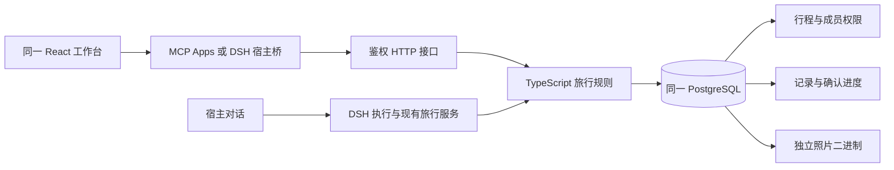
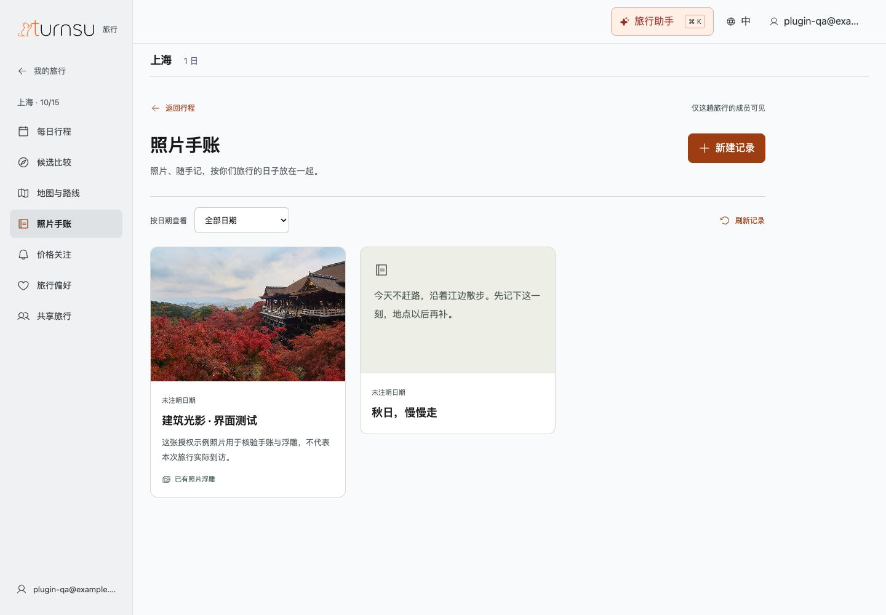

# Turnsu 统一工作台：实现与验证

日期：2026-11-11。用户在宿主对话中规划，打开插件查看和调整同一趟旅行。此前两条分支分别提供主旅行画布、手账等完整交互，本轮将它们合入 PR #7 的 React／DSH 主线，避免继续维护两个运行界面。本文记录本地实现，不表示已生产部署或通过公开插件审核。

## 用户现在可以做什么

旅行导航、日期安排、照片手账、浮雕、目的地沉浸、共享和采用前审阅使用同一个 React 工作台。桌面保留左栏，手机和窄栏使用顶部 Logo 与菜单。Turnsu Logo 使用用户提供的原始矢量素材；进入动画在每次插件重开时播放一次，启动中的界面切换接续同一时间进度，减少动态效果时直接显示导航标识。

手账可独立于过期候选建立：文字、日期、到访和最多三张照片组合保存；照片排序不改变身份。浮雕明确保存参数，原照片不被覆盖，未保存离开会提醒。目的地场景可探索和返回原位置，并明确风格化与来源边界。

拥有者通过已注册的 Google 邮箱查找账号，核对后授予查看或编辑权限；编辑者不能管理共享。授权涵盖同一旅行的安排、记录和媒体。撤销后，新的读取、照片请求、写入及旧请求恢复均需重新检查当前权限；同一事务暂停该账号为此旅行建立的价格关注，使在途报价失效，并取消尚未发送的提醒。已下载副本无法收回。

采用前的未知条件显示在受影响到访或交通段旁。确认进度按账号保存；依据未变的项保留，替换地点后只重新确认实际受影响的条件。确认未知并不把事实变成已核验：采用结果保留 `tentative` 标记和缺口；已知超预算、时间冲突、过期来源、锁定项冲突继续阻止采用。

## 只有一条正式数据路径

正式画布不再调用 Java／Preact 服务。该分支继续复用原有旅行版本、草案、可行性检查、撤销、DSH 执行代次和 PostgreSQL。记录与照片不进入模型的 TripState；图片、账号查找和共享资料通过应用专用结果返回，MCP 助手可见内容仅包含完成状态。Google 邮箱在浏览器规范化后计算摘要，服务端目录存摘要及已验证账号关联，不保存邮箱原文到旅行或任务。

新增工作台事务与行程提交使用同一个旅行行锁。共享拥有独立权限版本，记录拥有独立编辑版本；后台执行和普通 HTTP 写入在持久化时检查当前角色，避免撤权或降为查看后仍提交。重复请求使用原请求标识恢复当前记录；删除后不因恢复旧保存而重新创建。

## 验证及边界

本地使用真实 HTTP、DSH 执行、PostgreSQL 和浏览器，旅行事实与模型回复明确为受控样例，Google 账号映射也为测试身份。已实际操作文字保存、照片上传、浮雕保存与重开、逐项确认、暂定采用、共享角色修改/撤销，以及桌面、390px 手机视口和600px窄栏。来源未返回坐标时，地图明确显示缺口，不生成假地图。

本地 MCP App 标准协议的摘要→展开→读取同一照片手账已走通，嵌入时没有第二套聊天；只代表本地协议环境。独立视觉复核对标题层级、可读来源和关闭入口的已列修正均评分解决；专用复核角色不可用，使用全新上下文的独立代理按相同合同执行。

`npm run check` 通过（含类型、现有回归、Web 构建及共享客户端合同）；新增 PostgreSQL 回归覆盖记录冲突、旧请求恢复、照片身份和源字节不变、角色与撤权、邮箱映射变化、确认隔离与保留、暂定采用/重试/撤销、已知超预算拦截、来源只刷新检查时间不清空确认、旧记录转换、在途编辑者降权写入拒绝及只读 OAuth 的 POST 查询、撤权使在途报价及排队提醒失效。Web、MCP App 和 DSH 插件构建可重建；较大的主入口和 Three.js 分块仍有构建体积提示。

真实 Google 回调、Codex／ChatGPT 原生安装、物理手机、授权旅行来源、邮件、容量、生产部署和公开目录发布尚未验证。既有“两三条整趟方向”设计未因本轮 UI 统一而自动变成已实现。原有价格关注仍可使用；本轮不宣称已完成所有来源的持续风险跟进。

## 界面证据

下图是隔离数据的实际运行界面；示例照片不是上海现场资料。桌面与手机的同一手账、显式保存浮雕及插件内读取分别保存，不能用静态截图替代持久化测试。

[手机手账](./assets/2026-11-11-unified-workbench/journal-mobile.jpg) · [手机浮雕](./assets/2026-11-11-unified-workbench/relief-mobile.jpg) · [共享](./assets/2026-11-11-unified-workbench/sharing-mobile.jpg) · [沉浸](./assets/2026-11-11-unified-workbench/immersion-mobile.jpg) · [开场中间帧](./assets/2026-11-11-unified-workbench/entrance.jpg) · [插件读取同一手账](./assets/2026-11-11-unified-workbench/mcp-shared-journal.jpg)

## 开发和升级

- 界面入口：`src/web/workspace/TurnsuFrame.jsx`、`JournalPanel.jsx`、`ReviewPanel.jsx`、`SharingPanel.jsx`、`DestinationView.jsx`；设计稿见[统一设计说明](../../design/unified-workbench/README.md)。
- 业务规则：`travel-agent-pi-package/src/core/workspace-service.ts` 与 `workspace-review.ts`；持久化：`src/persistence/workspace-repository.mjs`。
- 配置 PostgreSQL 后运行 `npm run db:migrate`。迁移只新增工作台资料、二进制、命令回执和 Google 摘要目录，不删除旧表。已有本分支手账在首次读取时按旅行事务转换为稳定照片标识；不导入其他分支或旧开发库。
- 旧 PostgreSQL 手账 HTTP 入口转接同一服务；旧数组序号照片 URL 返回 410，客户端应重新读取元数据。无版本的旧删除返回冲突，防止绕过新版规则。文件模式仅保留旧客户端本地合同，新工作台明确要求 PostgreSQL。
- 升级前备份同一数据库。回退应用不会删除新增表；旧客户端不能作为新版记录的完整编辑器，应先导出/保留新记录，避免把旧版本回退当作无损降级。
- 可重跑回归：`TRAVEL_TEST_DATABASE_URL=... node --import tsx --test tests/workspace-unification.test.mjs`。该命令只允许专用 localhost:55439/travel_plugin 数据库，逐测试创建并清理独立 schema。
- 本地操作环境：`TRAVEL_TEST_DATABASE_URL=... TRAVEL_UI_VALIDATION_SCHEMA=travel_unified_ui node --import tsx scripts/smoke-plugin-app.mjs`，提供 8809 端口的正式 Web 构建和受控 API；页面中的本地开发入口使用 `plugin-qa@example.test`。此环境不验证真实 Google 身份。
