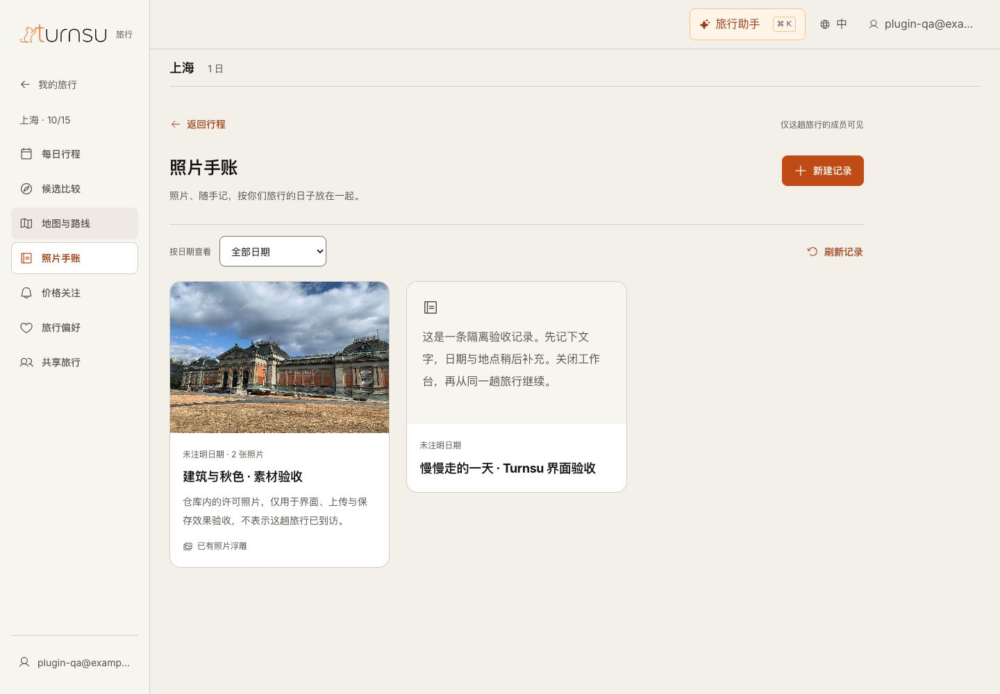

# Turnsu 设计规范接入与验收

2026-11-14。统一 React 工作台已接入 Turnsu Design System，覆盖行程、候选、审阅、手账、浮雕、沉浸、共享、偏好、价格关注及账号界面。正式 Web、MCP、DSH 与可操作设计稿共用样式；本轮没有变更旅行提交、授权或后台规划规则。

本轮完成的是设计规范接入及受控业务 UAT。真实 Google 登录、旅行供应商、邮件、Codex／ChatGPT 原生宿主和生产发布仍未验收。

## 设计结果

暖白底色、Inter 字体和墨色文字统一了之前的冷灰导航与灰绿媒体控件。原版 Logo 保持原样，主按钮、文字链接及成功／危险／待核验状态各使用规范中的对应颜色。控件、卡片、表单、分组、焦点和手机侧层采用同一语言。

桌面继续使用左侧导航；手机和窄栏使用顶部 Logo 与菜单。已确认的按天安排、地点联动、侧层审阅、文字手账、明确保存浮雕与指定账号共享均保留。Logo 的每次打开动画及减少动态效果分支未改变控制逻辑。

[手机手账](./assets/2026-11-14-turnsu-design-system/journal-mobile.jpg) · [窄栏](./assets/2026-11-14-turnsu-design-system/narrow-600.jpg) · [候选比较](./assets/2026-11-14-turnsu-design-system/comparison-desktop.jpg) · [逐项审阅](./assets/2026-11-14-turnsu-design-system/review-mobile.jpg) · [浮雕](./assets/2026-11-14-turnsu-design-system/relief-mobile.jpg) · [沉浸](./assets/2026-11-14-turnsu-design-system/immersion-mobile.jpg) · [共享](./assets/2026-11-14-turnsu-design-system/sharing-mobile.jpg) · [MCP 画布](./assets/2026-11-14-turnsu-design-system/mcp-desktop.jpg)

## 实现与素材

固定设计插件版本为 1.1.2，随包样式版本为 1.1.1。固定 CSS、Inter 4.1 字体、许可证及 SHA-256 保存于 `src/web/design-system/`；旅行适配集中在 `travel-theme.css` 和现有组件样式中。原版 Logo 与插件素材字节一致，未重新绘制或改色。截图照片来自 lumoplank（CC0）与 Chainwit.（CC BY 4.0）；作者、原图与许可链接见[照片来源记录](../../design/unified-workbench/assets/sources.json)，原文件未改动。

入口最终加载同一适配层。Web 生成本地字体文件；MCP 将字体内联，DSH 复用同一工作台。运行时没有开发机绝对路径、字体 CDN 或新增 UI 运行库。

实际复核补齐了候选比较的正式分组、空地图与地点详情的暖色样式，并把测试来源标识转为可读名称；原始来源引用仍保留。对新增文件、名称和文字做了来源名称检查，未改写历史证据中的随机工具调用标识。

## 受控 UAT

使用真实 HTTP、DSH、PostgreSQL、浏览器、照片上传与 Three.js 渲染。账号映射、模型回答和旅行资料均为明确标注的受控样例，不调用真实 Google 或旅行来源。测试库独立于原 Docker 数据，本轮临时 PostgreSQL 仅监听本机。

| 用户路径 | 观察到的完成证据 |
| --- | --- |
| MCP 新建纯文字记录 → Web 旅行列表重开 | 同一旅行读回同一标题、正文与空日期，不要求地点或照片 |
| 上传两张许可照片 → 调整顺序 → 保存 | PostgreSQL 保存两张照片；重开顺序保留，浮雕继续绑定同一照片 |
| 调整浮雕 → 尝试离开 → 继续并保存 → 重开 | 未保存提醒有效；明确保存后读回“原色立体”，原图保持独立 |
| 手机共享 → 核对账号和权限 → 查看转编辑 → 撤销 | 每步有范围说明和服务端完成反馈；撤销后不再列为成员 |
| 审阅一项未知条件 → 关闭重开 → 完成其余条件 → 采用 | 1/6 进度保留；完成 6/6 后可采用；重开仍显示“暂定行程”和六项待核验缺口 |
| 地点详情 → 沉浸 → 章节、表现和导览 → 返回 | 实际三维场景可操作；返回原地点；不改变行程，不声称实景或导航事实 |
| MCP 重新打开 → 展开 → 手账 | 正式编译资源读回 Web 保存的文字、双照片及浮雕标记；未另建聊天或旅行状态 |
| 账号设置 | 窄栏个人资料可读取；选中态、44px 操作和暖白表面一致，内容无横向溢出；未提交账号修改 |
| 偏好与价格关注 | 关闭偏好时添加入口禁用；邮件服务未配置时明确说明，保留站内提醒入口 |

CSS 视口覆盖 1440×1000、1265×900、600×900 和 390×844。页面实测 `scrollWidth` 等于 `clientWidth`，手机侧层正文可独立滚动。主按钮计算样式为规范操作色、白字、44px 高；正式 Web 与 MCP 显示同一字体和控件样式。页面与 MCP 控制台未出现运行错误。

截图是工具返回的原生 JPEG，没有后期缩放或裁剪。其位图尺寸可能与 CSS 视口不同；`capture-metadata.json` 记录重拍时的真实视口、可用宽度及组件边界，按 CSS 视口判断断点。账号栏的省略来自界面自身的文字省略规则。

## 工程检查与边界

- Web、MCP 与 DSH 构建通过；原有大分块提示仍存在。
- 照片、交互、编辑恢复、账号与插件聚焦回归通过；其中旧 PostgreSQL 账号用例因其专用变量未设置而跳过，未当作通过。统一工作台的 PostgreSQL 用例实际执行，覆盖权限撤销、旧结果隔离、媒体身份与逐项确认。
- 静态设计扫描执行一次，提示旧设计文档中的字阶与圆角记录不一致；组件已收敛到固定规范变量，设计记录随实现更新。
- 独立代码与视觉审查发现详情辅助字过小／对比不足、文字操作不足 44px、详情标题前重复标签三项问题，已修复。修复评分为 `ship`，仅覆盖这三项及本批回归；使用独立通用代理执行同一审查合同。
- 修复后重跑受影响的编辑恢复、交互及 MCP 合同检查通过；实测详情标签 12px、价格值 16px，辅助文字对暖白背景约 6.04:1，手账返回与照片编辑按钮均达到 44px。共享按钮尺寸在同一组件的既有设计测试成员页只读复核为 44px，见[尺寸复核图](./assets/2026-11-14-turnsu-design-system/sharing-controls-mobile.jpg)。一次追加测试共享提交被自动审核拦截后已取消，没有通过其他渠道执行授权；前面的真实 PostgreSQL 共享／改权／撤权证据保留。
- 账号侧栏遗留绿色选中态已接入同一规范变量；600px 实际渲染及四条样式的独立复核为 `ship`，未改变布局、权限或账号行为。
- 第一次审查要求重拍截图。已保留完整边界的原生输出并补充视口测量，不通过调整图片伪造尺寸。

本轮没有重新验收真实宿主、Google 回调、数据授权、邮件投递、500 在线容量或公开目录发布。减少动态效果与 Logo 会话触发保持现有实现，系统设置变化下的完整动画未在本轮重新录制。完整能力状态继续以 [Plugin App 与 DSH](../current/17-plugin-app-and-dsh.md) 为准。
